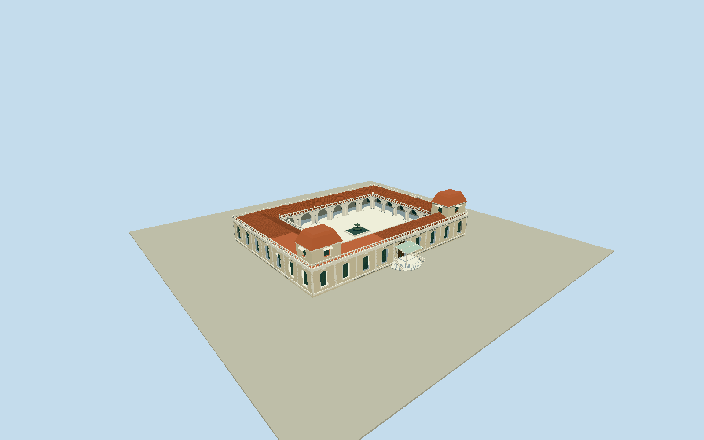

# Miraflores Palace, Caracas

WholeprincipalhistoricMirafloresPalacecourtyardbuilding, original4vertexouterand4vertexopencourtyardhole: lowhigh-ceilingmainwings/wholeback/sides, rusticatedcreamwalls/whitecornices/tallsegmentalwindows/doorrecesses, balustradeparapets, twofrontcornerraisedpavilions/redtilemansardcaps, intrinsicraisedentry/curvedbalustrades/thinmetal-glasscanopy, openarcadedcourtyard/tiledwingroofs/centralfountain. Notfullnamedpresidentialcompoundextrusionorfront-onlycrop. Excludeadjacentofficebuildings/helipad/wholecompoundgrounds/plantedgardens/palms/flags/people/interiors/presidentialsealtext. Preserveall4originalouter/courtyardvertices andphysicallyopenverticalcourtyard. Nativepartheightsabsent: originalphotoestimatesfor1highmainfloor/2raisedfrontcornerpavilions/tiledmansards/lowcourtyardarcadesandwingroofs/hiddenrear; do notextrudefullnamedcompound. Realstreet/closeuptallwindow/doorrecesses/whitearchframes/rusticatedpilasters/cornices/stonebalusters/canopymetalframeandglass/raisedcurvedentry. Courtyardarcadeshaveactualthrougharchesandcolumns/openroomlessgallery, intrinsiccentralfountain/pavingwithinmappedholeonly. No roof/floorcoveroverthewholecourtyardaboveground. Coarsenwindow/arch/balustercountsatdistance preservewholeopenplan/roofpavilions. Excludeflags/letters/people/palms/plantedgardens/adjacentofficeblocks/helipad/wholecompoundsitefloor/roominteriors. Freeze400mfieldatfixedoutboardwestfrontbeforegeometry; rawvaluesunchanged/no fit/flatten. Hostthreshold/groundattachmentunverified.

Authoring state: **review-in-qa.json**. Current completion evidence is in [qa.json](qa.json) and the [completion ledger](../../../../qualla-structures/batches/qualla-002.PROGRESS.md).

- [Miraflores Palace](https://qualla.com/miraflores-palace/)

Originalprincipalbuildingrelation19788212/building=government/multipolygon, outerway1447100847/all4vertices andinnerway1447100846/all4courtyardvertices. Bothcontainedinside namedcompoundway215101101/Q607224, whose6vertexsiteboundaryconfirmsidentityONLY/notbuildingfootprint. Meanoriginaloutervertexanchor, +Xalongwestfrontface3toward0 and+Zwestwardoutwardnormal; facadebearingandwestentryassignmentareoriginalboundedphoto/nativeinterpretation, notsurveyedentrancebearing. Nativewholeouter/courtyardgeometryunchanged; noheight/componentdata, twofrontpavilions/roofsections/entry/arcadesareoriginalphotoestimates.

ThreeexactpublishedClementeRJ/RJ1ownPD-self1996/1998Quallaoriginals inspected/nativeSHA1matched/item-specificgrantsbound/existingpolicypasses.34families/0conflicts; politicalhero/uncleararchival/USGovvisit/interiorpainting/historicversions/attribution-onlyimagesunused. No officialsourcephoto/architecturediagram/generatedbitmap/photo texture/downloadedmesh.

Originalwhole4vertexouterand4vertexopeninnercourtyard retained withfullprincipalwings/back/sides. Nativecomponentheightsabsent: raisedfloor1.2m/mainwall7.2m/outerbalustrade8.3m/courtarcade5.8m/balustrade6.8m/wingridge8.8m/twofrontpavilions11.3m/mansard14.3m areoriginalphotoestimates. Westentryassignment/frontbearing/raisedpavilioncount/hiddenrear/roofprofiles/metricheight/currentcosmeticsbounded, notsurveyedcurrentcondition.

Recognizablecreamrustication/tallwindowanddoorrecesses/whitearchframes/cornices/floralcartouches/stonebalusters, twofrontredtilemansardpavilions/upperwindows, raisedcurvedentry/wroughtmetalglasscanopy andwholeopenarcadedcourtyard/lowwingroofs/centralfountain. Representativewindow/arch/ornament/balustercounts; finepresidentialinsignia/letters/flags/interiors/plantings/palms/people/roofgearomitted. Intrinsiccourtyardpaving/fountainonly, neverroofedcourtyardorfullcompoundsitefloor.

Independent400m129x129/16641values/4rawTerrariumtiles frozenbeforegeometryunchanged/no fit/flatten/reacquire. Portable/shared/contextflatstage separate; liveurbanhostterrain/thresholdcontactunverified. Nativepreview/replaceFootprint=false. Named6vertexpresidentialcompoundidentity-only; separateofficeblocks472476108/472476112/helipad1268322522/restofcompoundexcluded.

Build: `node packages/worldgen/scripts/generate-authored-places.mjs --ids=miraflores_palace`. Add `--check` to verify exact regeneration. 35564 triangles; 6 materials; no embedded photographs.
