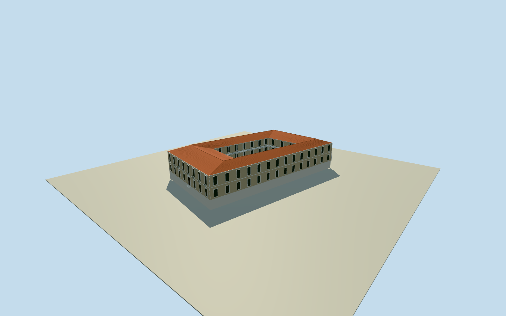

# Casa Amarilla, Caracas (1870)

Complete Casa deGobierno/CasaAmarilla in the coherent1870phase depicted by RamónBoletPeraza: entire two-storey palace envelope withlong creamplaster front, whitewindowcasings/cornerquoins/cornice, ironbalconies, centralentry and complete hippedredtile mainroof, plus intrinsic rear/courtyard wings and original lowreturns where supported. Currentnativewholeway is boundedsite/envelope context, not a surveyed1870plan; hiddenrear/courtyard/roofjunctions and heights willbe explicitarchitecturalestimates. Exclude adjacentrightmunicipalpalace/plazapaving/people/trees/flag/naturalhills and later1874memorialpavilion/decorative alterations not depicted. Not a current1874-remodel or2026survival certification, and not a facade-only model.

Authoring state: **review-in-qa.json**. Current completion evidence is in [qa.json](qa.json) and the [completion ledger](../../../../qualla-structures/batches/qualla-002.PROGRESS.md).

- [Yellow House (Venezuela)](https://qualla.com/yellow-house-venezuela/)

Whole1870physicalpalace, notlater1874neoClassicalremodelor2026currentstate. Originalcreamplaster/redtile/ironbalconies preserved; no anachronisticyellowpaintor1874memorialpavilion.

Currentnativewholeoutline suppliesbounds/siteidentity only. Exact1870rear/courtyard/winggeometryandverticalsections requireboundedestimates; nothistoricmeasuredsurvey.

Neverreacquire/flatten/reframe/movefloors/mainsections tofitrenders. Freeze independentoriginalfieldbeforeallmainparameters/geometry.

The original1870frontshowsroughlyeightbays, rectangularcentralentry, smallironupperbalconies, palecreamwalls/whitecasings/cornerquoins/cornice andredhiptiles. Side/rearwindowcensus andentirecourt/roofjunctions are boundedestimates insidewholeactualsite, not silently copiedfrom1874remodel.

No original1870rear measuredplan survivesinourinputs. Onefullcourtyard/twostoreywings/plaincoveredgalleries are explicitperiod-compatible architecturalestimates; no assertedpost1874Ioniccapitals or memorialpavilion.

Nativewholecurrenthouse sixcontrols anchorfullhorizontalextent andpotentialrearwings. Oldversuscurrentenvelope differences andregistration±8m/bearing±8degrees remainapproximate.

Mainfloor+.54/upper5.74/eave10.94/hipridge13.54m androofpitch/doorprofiles/windowbays selectedonce aftersourcefield,beforegeometry. Never movefloor/mainparameters or editreacquirefieldforrenderviews.

Onlyintrinsicpalace/courtyardfloors/foundations constructed, notplaza/naturalhills/neighbormunicipalbuilding or broadterrainpad/cutout. Currentfieldcannotcertify1870contact.

Rooffluting is a simplified groupedbarreltile relief, not exactindividualtilephotogrammetry. Dormer/flag/coats of arms/plaza/figures/trees/neighbormunicipalpalace not copied from painting.

Fullcurrentnativeouterenvelope supplies a bounded1870extent, whilehistoricalrear/courtyardtypology is explicitestimate. No currentstate or exactarchaeologicalhistoricalplanclaim.

Isolatedportableground liesbelowintrinsicfoundations; it is diagnostic, not1870gradecertification.

Build: `node content/worldgen/source/places/d9/d9b/yellow_house_venezuela/models/generate-house.mjs`. Add `--check` to verify exact regeneration. 33636 triangles; 6 materials; no embedded photographs.
