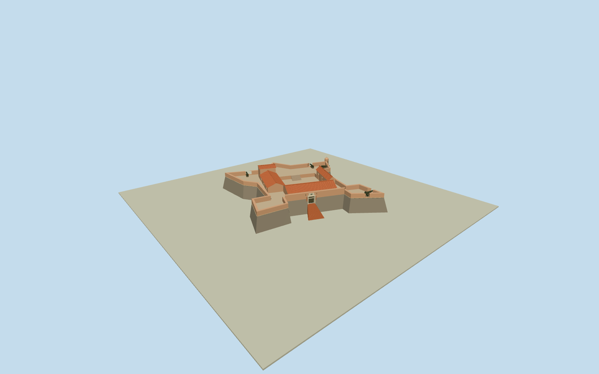

# Santa Rosa de la Eminencia Castle, La Asunción

Whole SantaRosa de laEminencia Castle at LaAsuncion/Q7419927:19 nativeouterbastion/curtaincontrols, batteredroughrubble fortwalls with restrainedbrickrepairs, ochreplasteredparapets/artilleryembrasures/intrinsiccannons, wholeopenairflagstonecourtyard andraisedwalk, lowterracottaroofedbarracks/centralarchpassage/smallsquareguardroom, small domedcornersentry/bartizan, woodenstuddedgatedoor/palestonejambandcresttablet/taperedbrickentrystair. Internalarrangement/sections/exactcensus/hiddenfaces original estimates, no closedroominterior. Road/landscape/hill/trees/people/antenna/flags/lettering/otherislandforts excluded.

Authoring state: **review-in-qa.json**. Current completion evidence is in [qa.json](qa.json) and the [completion ledger](../../../../qualla-structures/batches/qualla-002.PROGRESS.md).

- [Santa Rosa de la Eminencia Castle](https://qualla.com/santa-rosa-de-la-eminencia-castle/)

Actual namedCastilloSantaRosa/LaAsuncion/Margarita/Q7419927/nativeway203587857,19 original unique bastion/curtain perimeter controls. Whole fort architecture with intrinsic open-aircourtyard/artillerywalk/barracks/gate-stair, not a solid extruded fort block. No separate mapped internal roomoutline; original bounded internalplan/sections/roofs/cannoncounts andbearing estimates from exactQualla panoramas/entrancephotos. Distinct PampatarSanCarlosdeBorromeofort/otherisland attractions excluded. Fixednativebboxmidpoint/+Xeast/+Zsouth/heading0; nativeperimeterretained.

Independent400m129x129/16641samples/two originalrawtiles frozen before everyfloor/section/geometry decision. Structuralfloor0 relativefixed96.5453m provider datum is an unsurveyed architecturalreference, never hillfit. Original sectionestimates from exactpublishedCC0originals: lowercourt3m/artillerywalk4.2m, fullnative19control batteredrubblewall with .65m insetupperedge, ochreparapets1.3m above walk/frontgate6m, gatefloor2.7m/1.7x2.15m realwooddoor/15taperedbricksteps/cresttablet/slits, lowU-shapedbarracks/eaves5.85m/ridge7.05m, higherguardroof8.3m, cornerturret/embrasures/fiveboundedcannonplacements. Original internalrectangles/roofsections/openarchpassage/hiddenwindowcensus/cannoncounts/bartizanposition inferred from panoramic/photo views rather than protectedplan. Preserveall19outerbasecontrols and completefort/openaircourt/raisedwalk; no solidwholeforttop/courtyardfill orhill/road/siteplate. Exacthillfooting/gatestepcontact unresolved, geographicpreview/replaceFootprintfalse; rawfield immutable.

Whole native19-control fort/bastions/batteredroughrubblecurtain/ochreparapets/realopenembrasures/fiveintrinsiccannons/wholelowercourtyardandraisedwalk/Ushapedlowbarracks/trueopenarchpassage/higherguardroom/domedbartizan/realrecessedwoodgate/cresttablet/taperedbrickentrystair. Interiorroomplan/heights/batter/roofprofiles/cannoncensus/gatestation/bartizanlocation/hiddenwindows original boundedphotoestimates, notmetricpanorama projection or privateinterior. Finecrest is simplified originalrelief withoutlettering.

Five exactpublishedQualla creatorOwn/selfCC0 originals byWilfredor/ThePhotographer individuallyinspected/nativeSHA1matched. No supplemental photos/generatedbitmap/photo textures/copiedmesh/protectedplan/rightsmetadata repair. Otherislandforts/roads/trees/hill/people/antenna/flags/lettering excluded.

Six actualmaterialcombinations maximum: stone_drywall/plaster_lime/clay_fired/stone_limestone_raw plusopaquewood/metal palettes. Physicalbarreltile ribs/windowbars/doorstuds/hollowcannonbores atnear levels; skyline preserveswholefort/court/roof/arch/gate/cannons withreducedprofiles.

Independent400m129x129/16641values/two rawTerrariumtiles frozen before allfloors/sections/geometry. Floor0 relativefixed96.5453m datum unsurveyed; exacthillfoundation/gatestep/plazaattachment unresolved. No fieldfit/flatten/reacquire, geographicpreview/replaceFootprintfalse. Intrinsiccourt/gunwalk arestructure; no hill/road/siteplate.

Build: `node packages/worldgen/scripts/generate-authored-places.mjs --ids=santa_rosa_de_la_eminencia_castle`. Add `--check` to verify exact regeneration. 9534 triangles; 6 materials; no embedded photographs.
