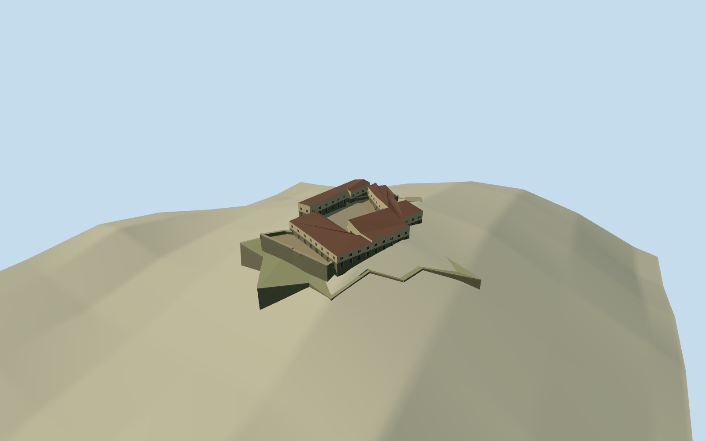

# Fort George, Grenada

The masonry headland fort overlooking the Carenage, with nested bastioned walls, a central parade, historic barracks and a lower approach.

Authoring state: **review-in-qa.json**. Current completion evidence is in [qa.json](qa.json) and the [completion ledger](../../../../qualla-structures/batches/qualla-004.PROGRESS.md).

- [Fort George, Grenada](https://qualla.com/fort-george-grenada/)

Draft exterior: approximate photographic proportions and simplified ornament. It is not a survey, photogrammetric reconstruction or approved current geographic replacement.

The OAS heritage survey describes intact ramparts and the stepped approach. The Grenada Tourism Authority identifies the parade, barracks, guardhouse and underground casemates. Only the observable standing exterior is represented.

Terrain sampling/contact, geographic alignment and site activation remain pending. Runtime LODs are produced by the registered after-import pipeline and require visual review.

Reference photos remain in the local Qualla corpus; only provenance, paths and hashes are retained here.

Build: `node content/worldgen/source/places/dd/ddh/fort_george_grenada/models/generate-fort-george-grenada.mjs`. Add `--check` to verify exact regeneration. 8124 triangles; 8 materials; no embedded photographs.
