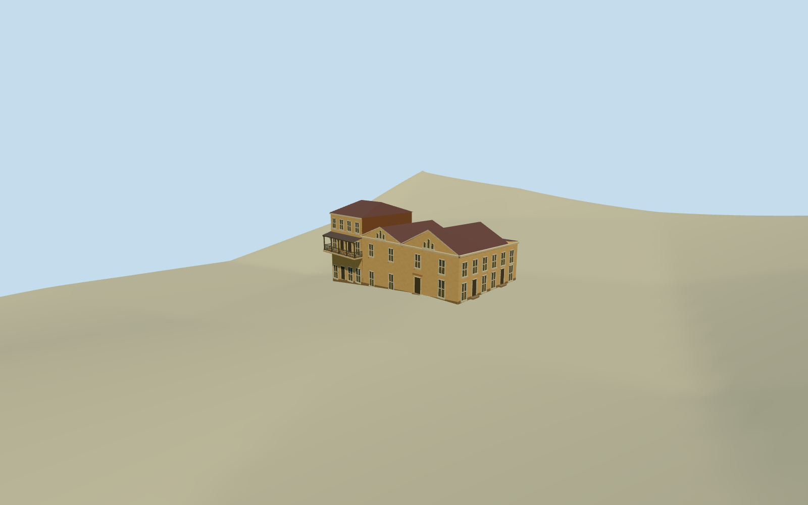

# Grenada National Museum

The former Home Hotel corner with twin gables, timber shutters and an adjoining iron-balcony wing on Grenada’s Monckton and Young Streets.

Authoring state: **review-in-qa.json**. Current completion evidence is in [qa.json](qa.json) and the [completion ledger](../../../../qualla-structures/batches/qualla-004.PROGRESS.md).

- [Grenada National Museum](https://qualla.com/grenada-national-museum/)

Draft exterior: approximate photographic proportions and simplified ornament. It is not a survey, photogrammetric reconstruction or approved current geographic replacement.

The 1902 Home Hotel frontispiece shows the twin gables, four principal bays, rear roof slope and the adjoining taller wing. Museum records identify its later enlarged balcony.

Terrain sampling/contact, geographic alignment and site activation remain pending. Runtime LODs are produced by the registered after-import pipeline and require visual review.

Reference photos remain in the local Qualla corpus; only provenance, paths and hashes are retained here.

Build: `node content/worldgen/source/places/dd/ddh/grenada_national_museum/models/generate-grenada-national-museum.mjs`. Add `--check` to verify exact regeneration. 4774 triangles; 8 materials; no embedded photographs.
