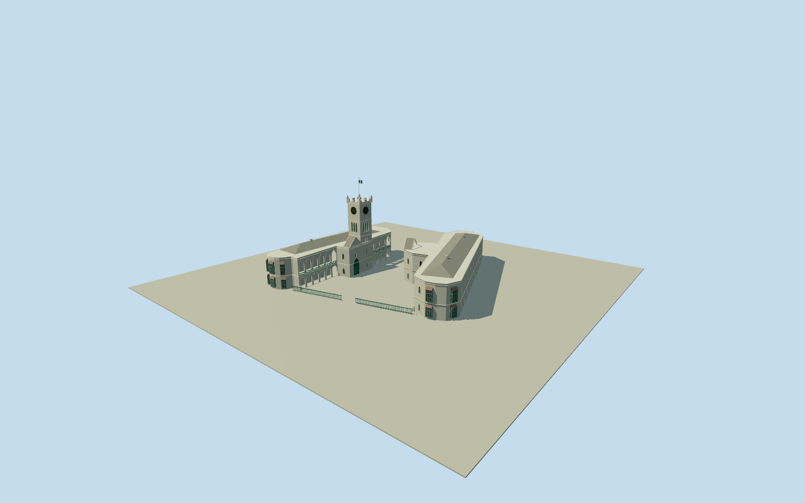

# Parliament Buildings, Barbados

Both native coral-limestone neo-Gothic Parliament wings and open V-shaped courtyard: rounded/faceted ends with projecting green shuttered oriels/sloping red-brown hoods/brackets, genuinely open upper pointed galleries and lower round arcades with green balustrades, corbelled parapets, low hipped roofs/gabled courtyard entrances, stepped buttress feet and surviving west square clocktower with four black/gold Roman dials, pointed louvred lights, battlements, corner pinnacles and flagpole. Intrinsic front green iron railings; no vanished east tower or detached neighbors.

Authoring state: **review-in-qa.json**. Current completion evidence is in [qa.json](qa.json) and the [completion ledger](../../../../qualla-structures/batches/qualla-002.PROGRESS.md).

- [Parliament Buildings: Where Barbados Learned to Govern Itself](https://qualla.com/parliament-buildings-barbados/)

Original east named Parliament Of Barbados government buildingway385175774/Q7138905and separate west government buildingway385175773, both KGGroundSurvey2015. The west wing is matched by its adjacent court position, long gallery, rounded south end and projecting entrance/tower mass in the accepted photos/local two-wing story; it has no independent native name/wikidata. Full signed outlines are retained separately, including round/faceted ends and projecting blocks. Native map supplies no heights or separate clocktower polygon.

Four exact cleared published QuallaPD-selfdaylight originals control persistent exterior form.13mwall/15mroof,30mclock battlement, tower position within the native west projection, hidden elevation openings, roof sections and fine joinery are photographic medium-fi estimates. No native architectural height/survey or independent tower polygon exists. Clock hands are an authored static display; minute-exact current time/clock mechanics are not claimed.

Full signed wings remain separate; courtyard is open and not a building extrusion. The named east and unnamed government west footprints are associated by site/photographic form/local two-wing story, without inventing a native west name. The clocktower is on the WESTwing; demolished/sunken historical east tower is excluded. Detached Treasury/RBC/other buildings, interiors, roads, fountain, vegetation, people and vehicles are omitted.

Upper pointed and lower round galleries have real openings/reveals, shallow closed backing and walking slabs from district detail onward, with green balustrades. Skyline uses dark pointed panels on a simplified wall and drops fine shutter/corbel/fence detail. Oriel/window recesses, gabled entry decorative gates and flag are closed visual detail, not a traversable interior or exact reproduction of stained-glass/artwork.

Coral stone/trim, green timber/ironwork, muted roof/hood palette and geometric Roman numerals are original shared-surface/mesh authoring, not photographic texture. Small rear windows, buttress feet, fence alignment and flag bands are bounded interpretations; concealed roof additions and temporary work are excluded.

Footings extend.4m below a fixed open southern court approach selected before terrain sampling. Exact stair/foundation/terrain attachment remains approximate and host-dependent. Source relief is retained without a whole-courtyard platform or terrain flattening.

Build: `node packages/worldgen/scripts/generate-authored-places.mjs --ids=parliament_buildings_barbados`. Add `--check` to verify exact regeneration. 60921 triangles; 6 materials; no embedded photographs.
