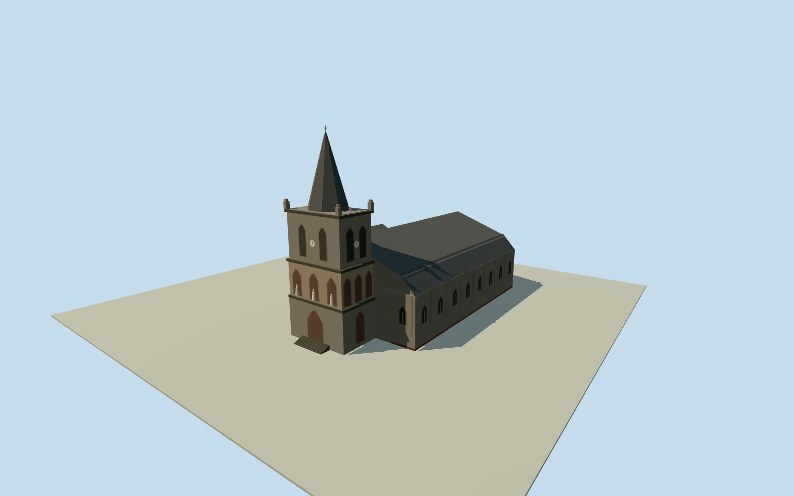

# Roseau Cathedral

Roseau Cathedral with a tall stone tower, historic spire, pointed openings and weathered masonry ranges.

Authoring state: **review-in-qa.json**. Current completion evidence is in [qa.json](qa.json) and the [completion ledger](../../../../qualla-structures/batches/qualla-003.PROGRESS.md).

- [Roseau Cathedral: A Century of Volcanic Stone, Prisoner-Carved Pulpits, and Kalinago Craftsmanship](https://qualla.com/roseau-cathedral/)

The exterior represents December 2008. The first of the month is a representative date because the photo records only the month.

Heights, rear walls, roof divisions and exact step grades are approximate. The portico and niche figures are simplified.

Interior rooms and the retaining wall beyond the mapped church are outside the model.

Build: `node content/worldgen/source/places/dd/dds/roseau_cathedral/models/generate-house.mjs`. Add `--check` to verify exact regeneration. 2286 triangles; 5 materials; no embedded photographs.
