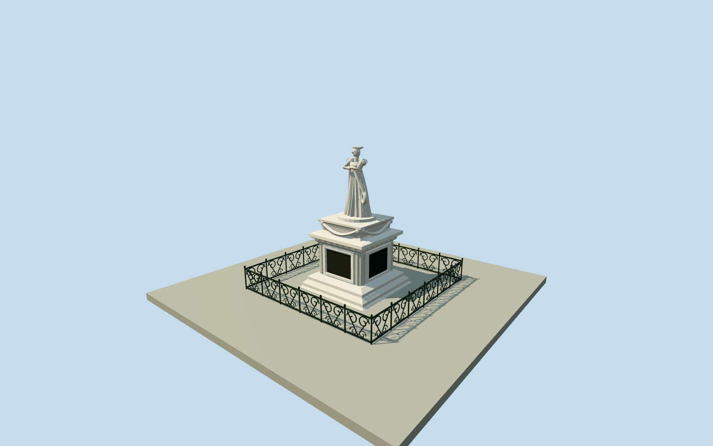

# Statue of the Empress Joséphine (1899)

Complete historical1899marble Josephine monument: intact head turned aside beneath carved curls/wreath, coherently posed exposed arms/hands gathered in front, fitted low-necked Empire bodice/puffed sleeves, fluted floor-length gown and asymmetric long draped robe/rolled side cloth. Stepped square paneled pedestal with dark plaques, raised moldings/cornice, upper festoons and low ornamental iron scroll enclosure. Exact native demolished-monument point anchors location; estimated photographic dimensions/bearing/hidden sculpture. Historical1899only; excluded from present.

Authoring state: **review-in-qa.json**. Current completion evidence is in [qa.json](qa.json) and the [completion ledger](../../../../qualla-structures/batches/qualla-002.PROGRESS.md).

- [Statue of the Empress Josephine](https://qualla.com/statue-of-the-empress-josephine/)

Original named demolished memorialnode3009793475/Q16964842and heritagePA00105984identify the former monument at its native anchor. The point establishes location only, not bearing, pedestal perimeter or surviving statue. Published1899photograph controls the intact historical figure/base; pedestal/enclosure dimensions, heading and hidden sculptural sections are explicit medium-fi estimates.

Historical1899intact appearance only. The local story records1991beheading and2020toppling; native point is tagged demolished. Explicit1899-01-01to1900-01-01appearance interval represents only the dated photograph year. No current-world statue, later paint or beheaded state is inferred.

Estimated3.5mpedestal foot/3.24mupper base,2.8mfigure and6.6miron enclosure; no measured survey or documented original bearing. Hidden back, exact anatomy/fingers, fine facial/floral carving, lettering and iron scroll repeats are bounded original medium-fi interpretations. The complete visible pose, intact head/wreath, fluted gown/asymmetric robe, decorated pedestal and enclosure are included; no pedestal-only substitute.

Exposed anatomy is deterministically posed/baked from the public Molen figures kernel, with original photo-directed cloth, carved head/nose/eyelid contours/curls and marble ornament geometry. No runtime actor, imported sculpture, photo pixels or photographic texture. Neutral warm marble/dark iron palette is inferred from monochrome evidence.

Exact1200x1608published Qualla1899Salles/BNF/Gallicaoriginal controls the appearance. Source native SHA1and explicit expired-copyright releases are recorded. Anonymous/unrelated and modern attribution photographs unused. Palm trees, spiral lamp, park vegetation/roads/paving, people and neighboring buildings excluded.

Intrinsic narrow enclosure curb is retained; no whole-site platform or terrain flattening. Fixed southern approach point was chosen before terrain acquisition. Footing extends.28m beneath approximate datum; exact1899grade/foundation/host-terrain contact remain unverified. Wreath curls/face, cloth folds, pedestal relief and fence scroll detail simplify with distance.

Build: `node packages/worldgen/scripts/generate-authored-places.mjs --ids=statue_of_the_empress_josephine`. Add `--check` to verify exact regeneration. 37316 triangles; 4 materials; no embedded photographs.
