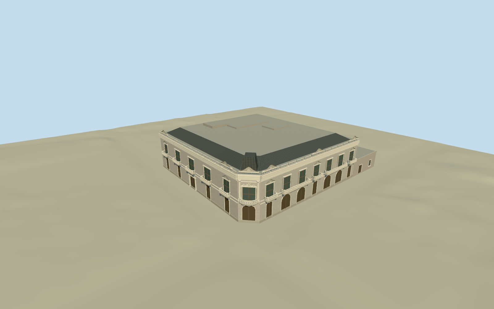

# Antiguo Casino de Ponce

The former Casino de Ponce at Calle Marina and Calle Luna, with the curved balcony, decorative relief and mission-tile mansard.

Authoring state: **review-in-qa.json**. Current completion evidence is in [qa.json](qa.json) and the [completion ledger](../../../../qualla-structures/batches/qualla-004.PROGRESS.md).

- [Antiguo Casino de Ponce](https://qualla.com/antiguo-casino-de-ponce/)

Roof and rear service volumes match the cleared aerial and contemporary footprint. Small plaster ornament is represented as shaped relief and fine interior detail is out of scope.

Colors use neutral light masonry, pale decorative trim and desaturated roofing. Exact paint and individual carved reliefs are approximate.

Build: `node content/worldgen/source/places/de/de0/antiguo_casino_de_ponce/models/generate-antiguo-casino-de-ponce.mjs`. Add `--check` to verify exact regeneration. 30648 triangles; 7 materials; no embedded photographs.
