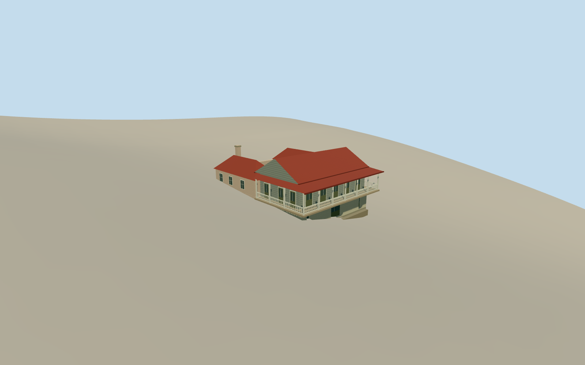

# Hacienda Buena Vista Manor House

The raised veranda, red zinc roof, masonry warehouse base and open upper courtyard of the Hacienda Buena Vista manor house.

Authoring state: **review-in-qa.json**. Current completion evidence is in [qa.json](qa.json) and the [completion ledger](../../../../qualla-structures/batches/qualla-003.PROGRESS.md).

- [Hacienda Buena Vista](https://qualla.com/hacienda-buena-vista/)

November 2023 manor house exterior, including the exterior-facing courtyard and veranda. Nearby drying, mill and service buildings are separate assets.

The pale west wall and red roof follow the cleared photograph. East finish, exact balcony joints and fine window details use documented dimensions and approximate materials.

Original elevations are preserved. The roofline follows the measured manor section. Historic garden and warehouse grades are approximate.

Build: `node content/worldgen/source/places/de/de0/hacienda_buena_vista/models/generate-manor.mjs`. Add `--check` to verify exact regeneration. 2508 triangles; 5 materials; no embedded photographs.
