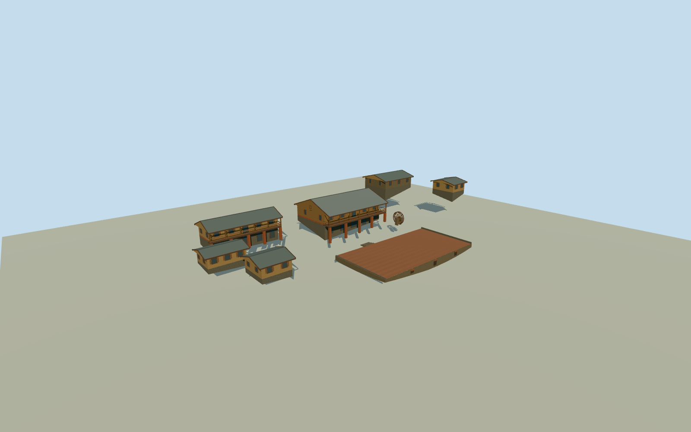

# Hacienda Lealtad

Lares hillside coffee estate with a timber and brick casa grande, corrugated zinc roof, timber coffee-range balcony, stepped dependencies and a masonry glácil.

Authoring state: **review-in-qa.json**. Current completion evidence is in [qa.json](qa.json) and the [completion ledger](../../../../qualla-structures/batches/qualla-003.PROGRESS.md).

- [Hacienda Lealtad](https://qualla.com/hacienda-lealtad/)

The main visitor buildings use the municipality’s published site, about 2.3 km from the Qualla article’s locality marker. The individual building functions and the drying terrace’s exact orientation are inferred from the mapped roofs, farm documentation and slope.

The USDA Qualla view shows an interior. Exterior siding color, window placements, rails, wheel detail and final elevations are reasonable estimates supported by the timber construction and masonry descriptions.

Build: `node content/worldgen/source/places/de/de0/hacienda_lealtad/models/generate-hacienda-lealtad.mjs`. Add `--check` to verify exact regeneration. 22606 triangles; 6 materials; no embedded photographs.
