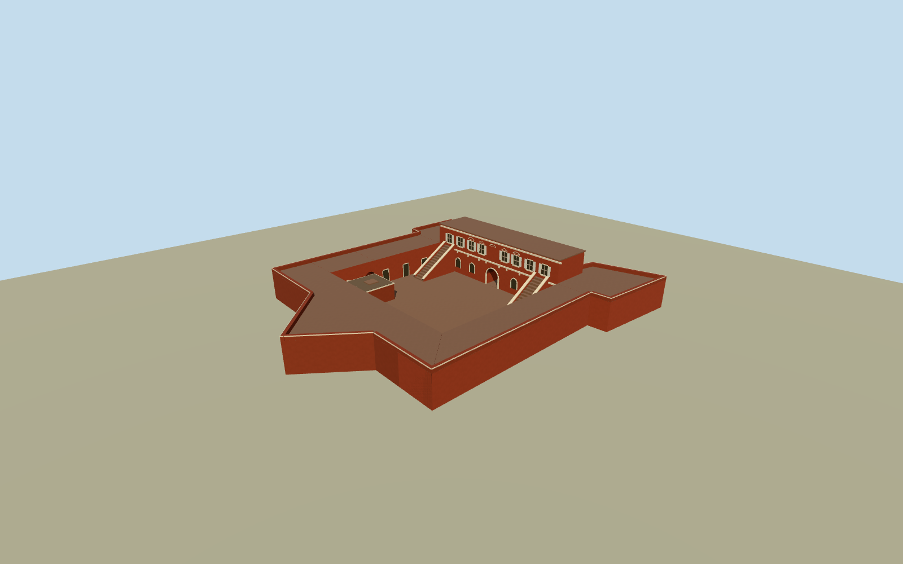

# Fort Frederik

Frederiksted’s Danish fort with red walls, white trim, paved courtyard, two-storey commandant’s quarters and masonry stairs.

Authoring state: **review-in-qa.json**. Current completion evidence is in [qa.json](qa.json) and the [completion ledger](../../../../qualla-structures/batches/qualla-004.PROGRESS.md).

- [Fort Frederik](https://qualla.com/fort-frederik/)

Standing fort building only. The separately situated former stables, lower seaside outwork and movable displays are outside the mapped building boundary. Fine masonry, woodwork and smaller openings are approximated.

Build: `node content/worldgen/source/places/de/de1/fort_frederik/models/generate-fort-frederik.mjs`. Add `--check` to verify exact regeneration. 4045 triangles; 5 materials; no embedded photographs.
