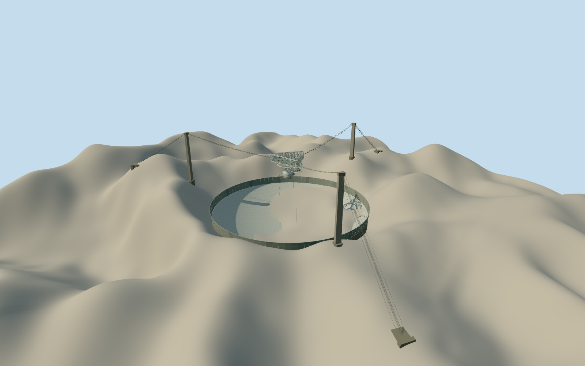

# Arecibo Telescope

Arecibo’s 305 m spherical reflector as it appeared in 2006, with three concrete towers, its steel suspension platform, curved arm and Gregorian dome.

Authoring state: **review-in-qa.json**. Current completion evidence is in [qa.json](qa.json) and the [completion ledger](../../../../qualla-structures/batches/qualla-003.PROGRESS.md).

- [Arecibo Telescope](https://qualla.com/arecibo-telescope/)

The date range covers the intact 1997 upgrade through the period before Hurricane Maria damaged the original line feed. The 2006 reference fixes the appearance. The arm and dome are shown in one plausible operating position.

Exact tower cap elevations, slab and truss sections, reflector support spacing and cable sag remain approximate. Ground footings follow original Terrarium elevations. A bounded render opening hides overlapping coarse terrain within the historical reflector rim while preserving its underlying elevation samples.

Build: `node content/worldgen/source/places/de/de2/arecibo_telescope/models/generate-arecibo-telescope.mjs`. Add `--check` to verify exact regeneration. 51210 triangles; 5 materials; no embedded photographs.
