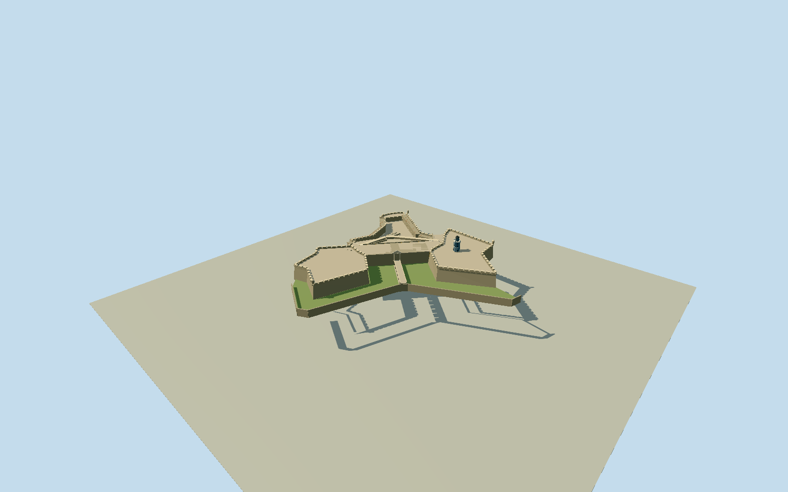

# El Morro

San Juan coastal fort with separate battered landfront bastions, six-arch entrance bridge and pedimented through sallyport, measured dry moat and counterscarp, open elongated parade and wraparound ochre/white arcade, high Caballero wall, stepped lower court and gun batteries with real ramps, corbelled garitas and blue-gray octagonal/square lighthouse with black helical lantern. Registered historical component plans checked against dated current photos; no monolithic8m map extrusion.

Authoring state: **review-in-qa.json**. Current completion evidence is in [qa.json](qa.json) and the [local 100 ledger](../../../../qualla-structures/batches/PROGRESS.md).

- [Castillo San Felipe del Morro](https://qualla.com/castillo-san-felipe-del-morro/)
- [El Morro: The Fortress That Guarded Spain's Empire](https://qualla.com/old-san-juan-el-morro/)

Outer native footprint is an approximate low-zoom mapped fort perimeter, not each tier or a construction survey.8m map tag must not become a uniform extrusion.

Local plan uses east/south signed axes. Lighthouse POI is an approximate horizontal control; actual base outline comes from inspected HABS/current photo evidence.

Independent current USGS D24 catalog labels vertical datum NAVD88; source-specific vertical metadata remains unverified. No datum transformation or absolute-level survey claim.

Original F32 export has empty sparse offshore blocks beyond the fixed256m review square; no source value is substituted/filled. All256m square samples must lie in nonempty original blocks.

Fine current materials/alterations and historical drawing dates must be distinguished.

Wall-top and toe registration differ by metres in the source maps; no cadastral claim.

Fine original curvature, concealed rooms, machinery and individual masonry weathering are simplified.

The frozen provider field retains existing roof/bridge/fort classification and may occlude voids in its review fixture; source geometry must still contain real openings.

Current trees/temporary scaffolding/visitors/flags/adjacent city works excluded.

Four terrace heights and individual minor alterations are photo/provider interpretations. Physical model-owned ground opening exposes the true bridge arches and galleries while preserving original provider samples for anchoring and restoring the terrain when the model hides. No hidden-room, safety, navigation or construction-survey claim.

Bulk photographs and measured drawing TIFFs remain in local evidence; original geometry/palette only, no copied photographic pixels. Review captures and source/runtime validation must be current before completion annotations.

Build: `node packages/worldgen/scripts/generate-authored-places.mjs --ids=el_morro`. Add `--check` to verify exact regeneration. 29200 triangles; 6 materials; no embedded photographs.
