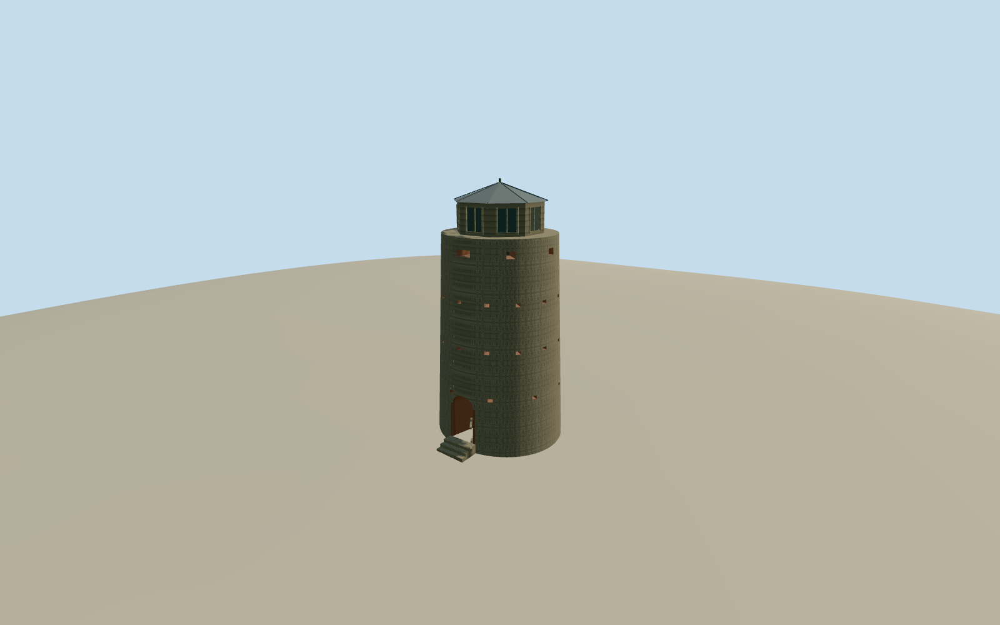

# Blackbeard’s Castle (Skytsborg)

Skytsborg, the Government Hill watchtower known as Blackbeard’s Castle, with its tapered stone shell, open north entry, gun ports and wooden observatory around 1918.

Authoring state: **review-in-qa.json**. Current completion evidence is in [qa.json](qa.json) and the [completion ledger](../../../../qualla-structures/batches/qualla-003.PROGRESS.md).

- [Blackbeard's Castle](https://qualla.com/blackbeard-s-castle/)

The NPS measurements control the masonry dimensions. The mapped perimeter gives a larger envelope around the site. Exact ovoid shape, radial opening positions, timber observatory measurements and colors are estimated from the records and prints.

The dated model includes the historical wooden observatory depicted in the postcards. The original public elevation field is preserved and the exterior step contact is approximate.

Build: `node content/worldgen/source/places/de/de3/blackbeard_s_castle/models/generate-skytsborg.mjs`. Add `--check` to verify exact regeneration. 2880 triangles; 5 materials; no embedded photographs.
