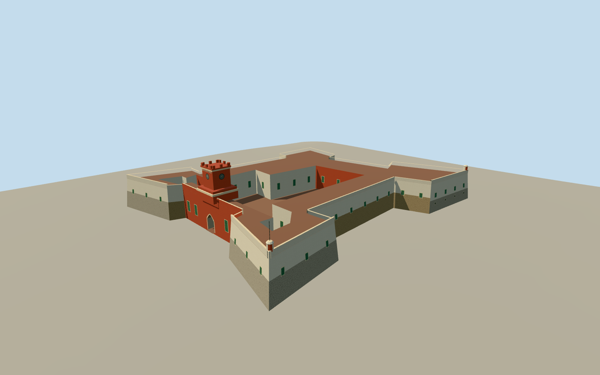

# Fort Christian, Charlotte Amalie

The four bastions, open brick court, weathered harbor walls, and red Gothic clock tower of Fort Christian in Charlotte Amalie.

Authoring state: **review-in-qa.json**. Current completion evidence is in [qa.json](qa.json) and the [completion ledger](../../../../qualla-structures/batches/qualla-003.PROGRESS.md).

- [Fort Christian](https://qualla.com/fort-christian/)

December 2011 exterior with the white and weathered waterfront masonry visible in the two cleared photographs. The clock tower and north entry are the Gothic Revival addition described in the landmark nomination.

Precise gate profiles, clock ornament, parapet repairs, rear openings and absolute elevations are approximate. The NPS nomination confirms the building configuration and open court.

The original elevation samples are preserved. Neighboring buildings, exhibits, historic weapons and room interiors are outside the model.

Build: `node content/worldgen/source/places/de/de3/fort_christian/models/generate-fort.mjs`. Add `--check` to verify exact regeneration. 2111 triangles; 4 materials; no embedded photographs.
