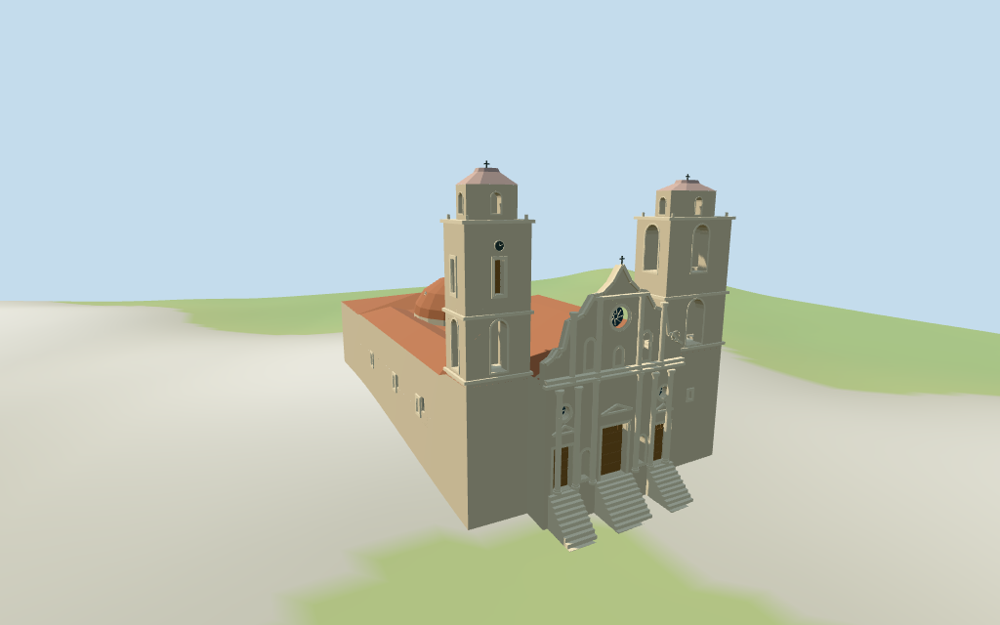

# Havana Cathedral

Individual Havana Cathedral:unequal narrow clock tower and broad two-stage open belfry frame a wavy carved pale-stone Baroque screen with three recessed timber doors,two column orders,blind niches,broken/curved cornices,simplified volutes and floral/oval glazing. Red clay pitched nave/aisle/rear roofs and mapped broad rear dome with arched sails and small open lantern/cap complete the envelope. Four raw map controls,four browser levels and four shared256-square material graphs. Fine figures/interlace/lettering,hidden annex partitions,full interiors/engineering and exact ground joins simplified or unverified.

## Evidence and reconstruction

Published dimensions and reconstructed details are separated in spec.json. Primary references:

- [Reference](https://commons.wikimedia.org/wiki/File:Havana_Cathedral_2024.jpg)
- [Reference](https://commons.wikimedia.org/wiki/File:Cathedral_roof,_Havana.jpg)
- [Reference](https://commons.wikimedia.org/wiki/File:La_Havane-Cath%C3%A9drale_(4).jpg)

Four existing cached256-square ashlar,continuous limestone,clay tile and wood graphs.Linear pale stone/tan timber/red roof tints,metric UVs,flat normals,six merged groups.No embedded images,unique facade maps or baked lighting.

## Model and axes

18,283 triangles; 54,849 vertices; 6 material groups; 2,197,608 bytes. Native bounds: -26.519, -3.009, -16.736 to 30.380, 31.700, 16.625. Source hash: `sha256:b159e60ae38adb54f6822027ba8f60e2fabf26dddce071af2cb2ef5edd967b77`.

{"x":"south-southeast toward Baroque plaza facade","y":"up","z":"west-southwest toward narrow clock tower;wide belfry on negative side"}

Standard viewer DEM datum11.732798m;estimated floor0.7m,raw whole perimeter-2.52..1.16m. Footings crossY=0 and extend below samples;shallow front landing/steps approximate. No preview flattening,host DEM change or road replacement. Exact plaza/street/door contact,base clipping,absolute altitude and walking remain unverified. Adjacent colonnaded plaza ranges,city buildings,sea,roads and temporary construction remain host content.

## Reproduce

Run `node packages/worldgen/scripts/generate-additional-landmarks.mjs --ids=havana_cathedral` (or add `--check`). The generator preserves manually edited masters by checking their baseline hashes. Import through the standard authored-model workflow with optimization disabled; then capture all QA cameras, including shared-surface views.

## Pending work

- Retained exact-QID way/23870813/Q15043487 matches current whole35184395959645. Current10 whole vertices plus4 narrow tower35184765394979,4 wide tower35184765394978 and19 dome-roof35184765394980 vertices retain all37 raw vertices/tags;earlier13 distinct whole vertices/multilingual identity remain intact. Main raw height11m and three component heights17m retained verbatim. Retained36m width/34m length facts have no reference URLs;current whole53.14x33.31m includes rear/side annex scope,so no forced rescale. Heading-1.15681402154rad signs+X south-southeast plaza/front,+Z west-southwest narrow clock tower;wide bell tower at-Z. All internal partitions,roof profiles and heights above estimated0.7m floor are approximate. Raw11m is used as main eave;17m dome control as red dome cap;17m tower tags are treated as lower bell-stage controls and do not establish full visible tower crowns. Picture-led upper stages/crowns reach narrow31.0m/wide30.4m;source tags remain unchanged and total tower heights are explicitly uncertain. Main nave ridge15.5m,facade crown21.6m/cross22.5m,rear lantern17.0..20.5m/cap21.8m/cross22.5m;side/rear eaves11m/roof12.5m. Fine carving,hidden bays,dimensional scope and height datum are unverified.
- Standard viewer DEM datum11.732798m;estimated floor0.7m,raw whole perimeter-2.52..1.16m. Footings crossY=0 and extend below samples;shallow front landing/steps approximate. No preview flattening,host DEM change or road replacement. Exact plaza/street/door contact,base clipping,absolute altitude and walking remain unverified. Adjacent colonnaded plaza ranges,city buildings,sea,roads and temporary construction remain host content.
- Medium-fi exterior from three actually inspected2015/2024 front/plaza and2019 elevated roof pictures plus standard viewer PMTiles/DEM.No bespoke plans/surveys.Fine sculpture/interlace/inscriptions,hidden annex roof/fenestration,full interiors/bells and engineering sections simplified or excluded. Raw17m tower controls do not establish full picture-led31/30.4m crowns;absolute height datum remains uncertain.Entrance steps adapt to retained coarse DEM and do not reproduce surveyed historic plaza grading.Adjacent colonnaded city ranges excluded.Physical phone/laptop timing pending.
- Skyline keeps wavy facade,unequal towers with real bell-stage/crown air,rear dome and open lantern. District adds shared textures,recessed doors/floral glazing/blind niches,column orders/cornices and detailed bell apertures. Street adds timber divisions,floral tracery,volutes and selected dome sails. Closeup/master refine nested trim,column facets,wood panels and cornice rhythms.Synthetic regional cottages are fixtures.

This bundle follows the medium-fi standard. Medium-fi appearance and geographic fit are reviewed separately. Hash-bound visual acceptance is recorded separately after capture inspection.

## Additional geographic data

©OpenStreetMap contributors;Protomaps;Mapzen/USGS terrain tiles.
