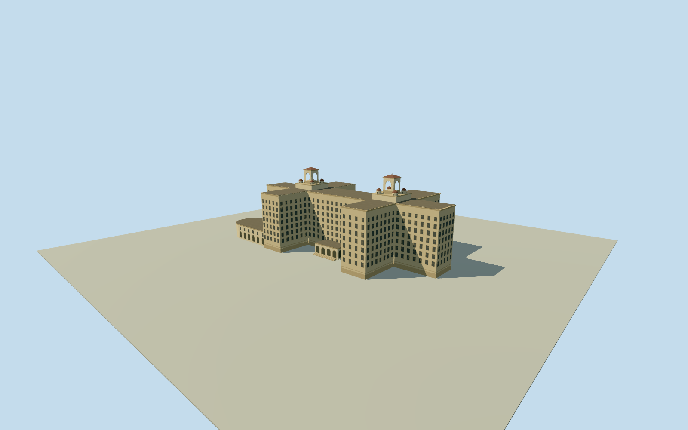

# Hotel Nacional de Cuba

Hotel Nacional de Cuba, with cream hotel wings, open tower crowns and red-roofed corner turrets.

Authoring state: **review-in-qa.json**. Current completion evidence is in [qa.json](qa.json) and the [completion ledger](../../../../qualla-structures/batches/qualla-003.PROGRESS.md).

- [Hotel Nacional de Cuba](https://qualla.com/hotel-nacional-de-cuba/)

October 2007 exterior, corroborated by a January 2006 oblique view. Main footprints and roof tower positions are mapped; heights and detailed window divisions are estimated.

The courtyard and perimeter use the original elevation source. Entrance thresholds, service areas and terrace elevations remain approximate.

Garden structures, interior rooms, vehicles and later decorations are outside the model.

Build: `node content/worldgen/source/places/dh/dhj/hotel_nacional_de_cuba/models/generate-house.mjs`. Add `--check` to verify exact regeneration. 10348 triangles; 5 materials; no embedded photographs.
