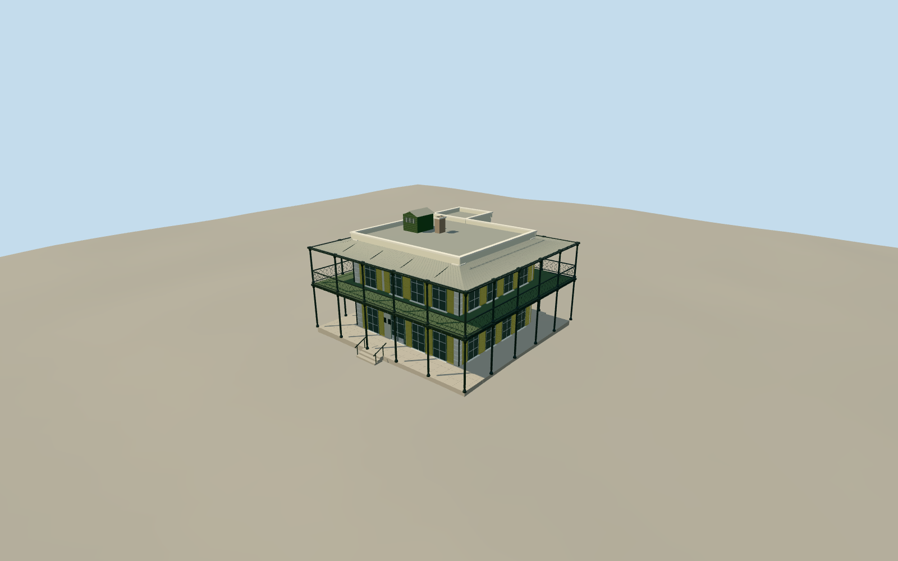

# Ernest Hemingway House

Two-story Key West limestone/stucco house with flat parapeted roofs, rear ell, wraparound open galleries, curved corrugated veranda canopies, slender iron columns, heart-pattern railing, arched yellow shutters and green/white casements. Small roof stair housing and two-flue chimney.

Authoring state: **review-in-qa.json**. Current completion evidence is in [qa.json](qa.json) and the [local 100 ledger](../../../../qualla-structures/batches/PROGRESS.md).

- [The Hemingway House: Where the Cats Outnumber the Tourists](https://qualla.com/ernest-hemingway-house/)

Original medium-fi exterior informed by individually inspected Qualla photographs (2006, 2009, 2019), HABS FL-179 architectural description and measured drawings. Main facade and gallery dimensions follow the measured plans; fine dimensions, parapet height and ornamental profiles remain interpreted.

Surviving museum exterior only; interiors, detached studio, removed studio catwalk, pool, cats, visitors, furniture and garden structures excluded. Historic roof and rear-ell evidence guide portions obscured in local photos.

Coarse mapped envelope is approximately one metre inside some measured gallery edges; it is retained as evidence without stretching the building. Placement is an approximate terrain-relative preview, with footprint replacement disabled.

Independent unmodified Terrarium elevations are preserved; ground contact is host-dependent, not a site survey. Reference photographs are not embedded or redistributed.

Build: `node packages/worldgen/scripts/generate-authored-places.mjs --ids=hemingway_house`. Add `--check` to verify exact regeneration. 36694 triangles; 6 materials; no embedded photographs.
