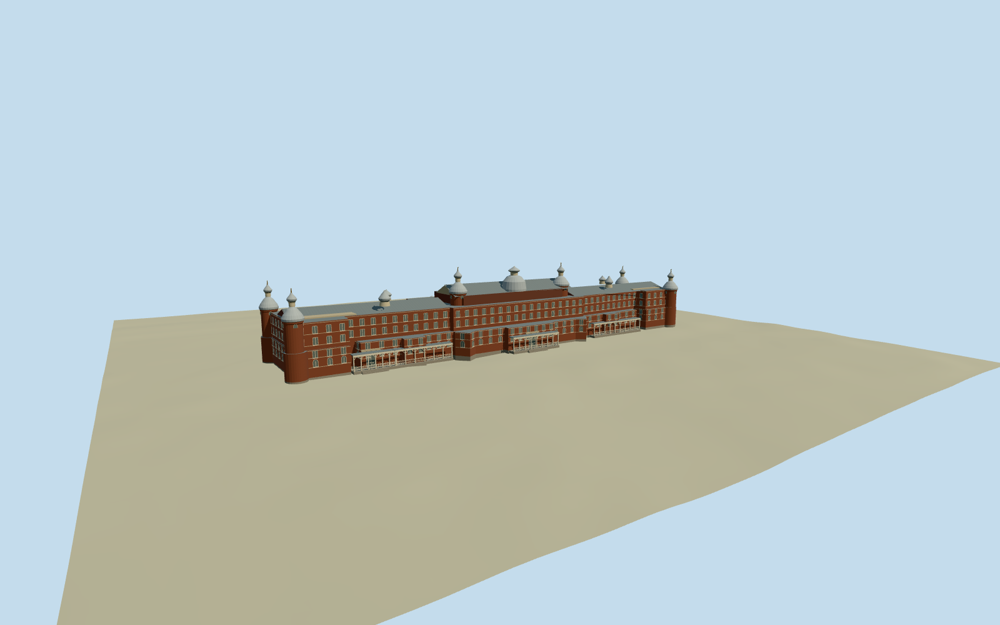

# Henry B. Plant Museum

Tampa’s former Tampa Bay Hotel with red brick, cream verandas, silver domes and six ornate minarets.

Authoring state: **review-in-qa.json**. Current completion evidence is in [qa.json](qa.json) and the [completion ledger](../../../../qualla-structures/batches/qualla-004.PROGRESS.md).

- [Henry B. Plant Museum](https://qualla.com/henry-b-plant-museum/)

Scope covers the present standing hotel building at the mapped Plant Hall footprint. Detached park structures are outside scope.

Door and window pattern counts on less photographed sides, smaller cupola positions and minor roof heights are approximate.

Build: `node content/worldgen/source/places/dh/dhv/henry_b_plant_museum/models/generate-henry-b-plant-museum.mjs`. Add `--check` to verify exact regeneration. 50338 triangles; 7 materials; no embedded photographs.
