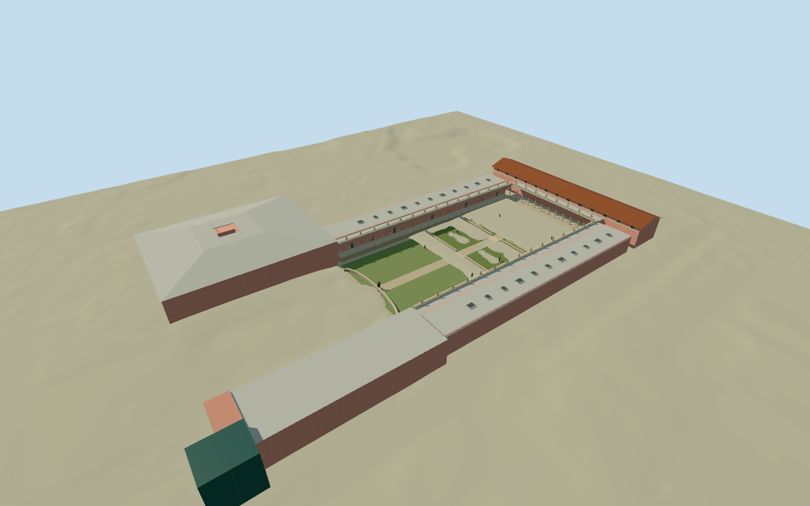

# John and Mable Ringling Museum of Art

The Ringling Museum of Art in Sarasota with open pink colonnades, a terraced sculpture garden, the tiled east range and the attached Searing and Chao wings.

Authoring state: **review-in-qa.json**. Current completion evidence is in [qa.json](qa.json) and the [completion ledger](../../../../qualla-structures/batches/qualla-004.PROGRESS.md).

- [John and Mable Ringling Museum of Art](https://qualla.com/john-and-mable-ringling-museum-of-art/)

Draft exterior: approximate photographic proportions and simplified ornament. It is not a survey, photogrammetric reconstruction or approved current geographic replacement.

The verified Qualla atrium photo establishes the Searing Wing’s square open aperture. Daderot’s dedicated courtyard original establishes the pink plaster loggias, roof balustrades and stepped court. National Register documentation describes the rusticated east entry.

Terrain sampling/contact, geographic alignment and site activation remain pending. Runtime LODs are produced by the registered after-import pipeline and require visual review.

Reference photos remain in the local Qualla corpus; only provenance, paths and hashes are retained here.

Build: `node content/worldgen/source/places/dh/dhv/john_and_mable_ringling_museum_of_art/models/generate-john-and-mable-ringling-museum-of-art.mjs`. Add `--check` to verify exact regeneration. 31491 triangles; 8 materials; no embedded photographs.
