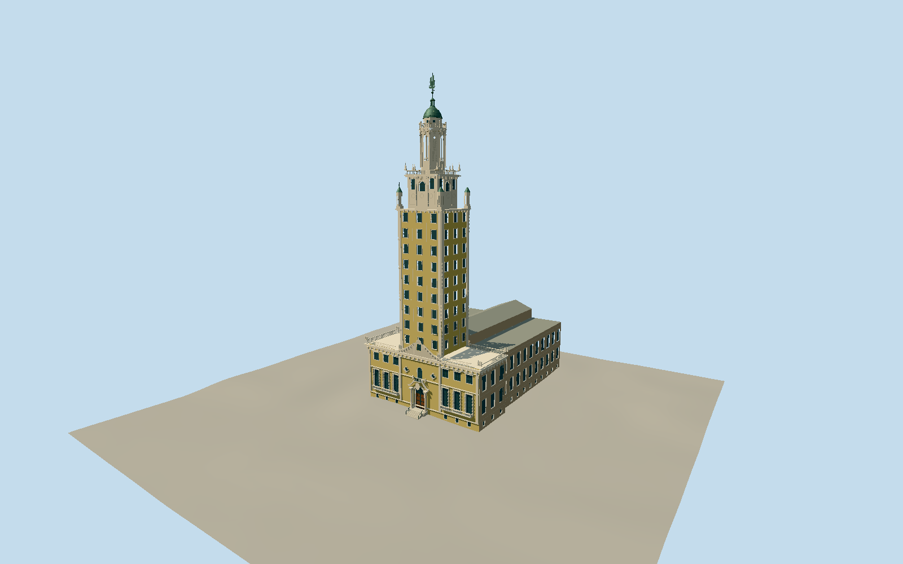

# Freedom Tower (Miami)

Historic Miami Mediterranean tower and attached plain west printing wing. Warm yellow stucco/pale cast-stone corner quoins and deep divided windows; nine plain three-column shaft levels. East portal has semicircular oak doors/fanlight, paired columns/capitals, broken scrolled pediment/original cartouche/abstract seated figures, iron balcony, glazed quatrefoils and large swept cornice/topwindow. Pierced base balconies/parapets/obelisks, raised front terrace/six entrance risers; rear plain divided casements/stepped central gable. Bracketed crown cornices, four real open roofed corner turrets, ornate square stage with arched/rectangular lights/roundels/cartouches, pierced balustrades/obelisks. Octagonal upper lantern with real cardinal arches/alternating blind niches and oculi, engaged columns/capitals, upper balcony/small windowed drum, paneled green copper dome/open beacon and original tall globe/cardinal-cross/ship vane. No neighboring campus/plaza/statue/interiors/scaffolds/photo textures.

Authoring state: **review-in-qa.json**. Current completion evidence is in [qa.json](qa.json) and the [local 100 ledger](../../../../qualla-structures/batches/PROGRESS.md).

- [Freedom Tower: Miami's Ellis Island of the South](https://qualla.com/freedom-tower-miami/)

Exterior geometry interpreted from2007–2018local originals;2025owner/2026heritage records confirm restoration. Exact current restoration block finish/paint tone is not surveyed.

86.3mCTBUHnominal overall control differs fromQualla255ft(~77.7m), native84.5mwhole/83mvane;19ft(5.7912m)historical restored-vane control. Native component plans retained; intermediate heights, windows, portal/crown ornament and roof engineering are estimates.

NPS125ftfrontage and253/189ftproperty lines are parcel controls, not building dimensions. Rear native20/25/17mheights are generalized; rear stepped gable/roof heights interpreted from actual local rear photograph.

Historic tower/base and directly attached printing wing included. No neighboring college/newlibrary buildings, Metromover, plaza/palms/statue/streetfixtures, event banners/scaffolds, interiors/mural or photo textures.

Original simplified cartouches/foliate/cherub-like silhouettes, obelisks and ship vane; no literal fine sculpture, inscriptions or heraldry. No baked colored night lighting.

Independent terrain acquired before geometry without fitting/flattening. Raised entrance and steps follow historic nominal3ft and photographed form; host urban DEM and threshold engineering remain approximate. Footprint replacement disabled.

Original native component outlines remain in this evidence file. Authored shaft and square-crown facade planes use their local rectangular bounds; skew/generalization deviations are under about0.5m. The irregular base outline remains direct. This is an interpreted exterior, not a measured survey.

Build: `node packages/worldgen/scripts/generate-authored-places.mjs --ids=freedom_tower_miami`. Add `--check` to verify exact regeneration. 48481 triangles; 7 materials; no embedded photographs.
