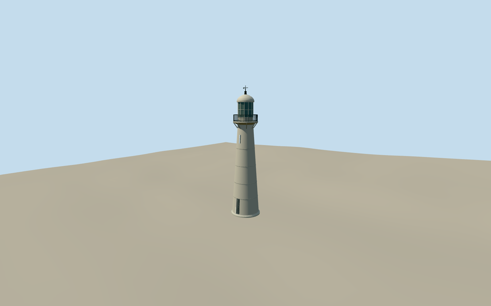

# Biloxi Lighthouse

Surviving white tapered cast-iron lighthouse with horizontal panel seams, recessed base door and narrow upper light, flared projecting catwalk, black open iron rails/brackets, twelve-sided glazed lantern, pale rounded metal roof, ventilator and weathervane. Tower and own footing only; demolished keeper house, median roads, site fencing, visitors center and temporary maintenance works excluded.

Authoring state: **review-in-qa.json**. Current completion evidence is in [qa.json](qa.json) and the [local 100 ledger](../../../../qualla-structures/batches/PROGRESS.md).

- [Biloxi Lighthouse](https://qualla.com/biloxi-lighthouse/)

Approximate19.5m overall height and photographic proportions; source heights vary with measurement convention. USCG historic tower photos/drawing control surviving iron silhouette, not every restored fitting. Hidden openings, pane count, doorway facing and weathervane are medium-fi interpretations.

Native quantized footprint supplies location, not a survey. Coastal host terrain is approximate; no terrain fitting or neighborhood reconstruction. Demolished keeper house, roads, fence and temporary restoration works excluded.

Original geometry; public-domain Coast Guard references remain in Qualla and are not used as textures.

Build: `node packages/worldgen/scripts/generate-authored-places.mjs --ids=biloxi_lighthouse`. Add `--check` to verify exact regeneration. 6324 triangles; 4 materials; no embedded photographs.
