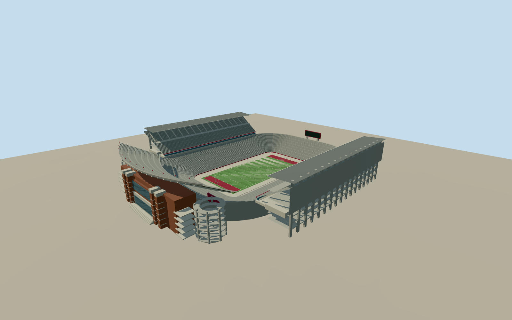

# Bryant–Denny Stadium

The 2008 Bryant–Denny Stadium, with its north upper stand, covered sideline decks and lower south bowl.

Authoring state: **review-in-qa.json**. Current completion evidence is in [qa.json](qa.json) and the [completion ledger](../../../../qualla-structures/batches/qualla-003.PROGRESS.md).

- [Bryant–Denny Stadium](https://qualla.com/bryant-denny-stadium/)

November 2008 stadium before the 2010 south-end upper grandstand. The south end has the lower bowl and single older replay scoreboard.

The playing field uses the mapped alignment. Modern mapped boundaries provide approximate retained limits. Historic stand elevations, row and bay counts, canopy details, screens and circulation sections are estimates.

Period photographs document the north façade, circulation and upper decks. Original terrain is preserved, with approximate field and foundation registration.

Build: `node content/worldgen/source/places/dj/djc/bryant_denny_stadium/models/generate-stadium.mjs`. Add `--check` to verify exact regeneration. 17374 triangles; 6 materials; no embedded photographs.
