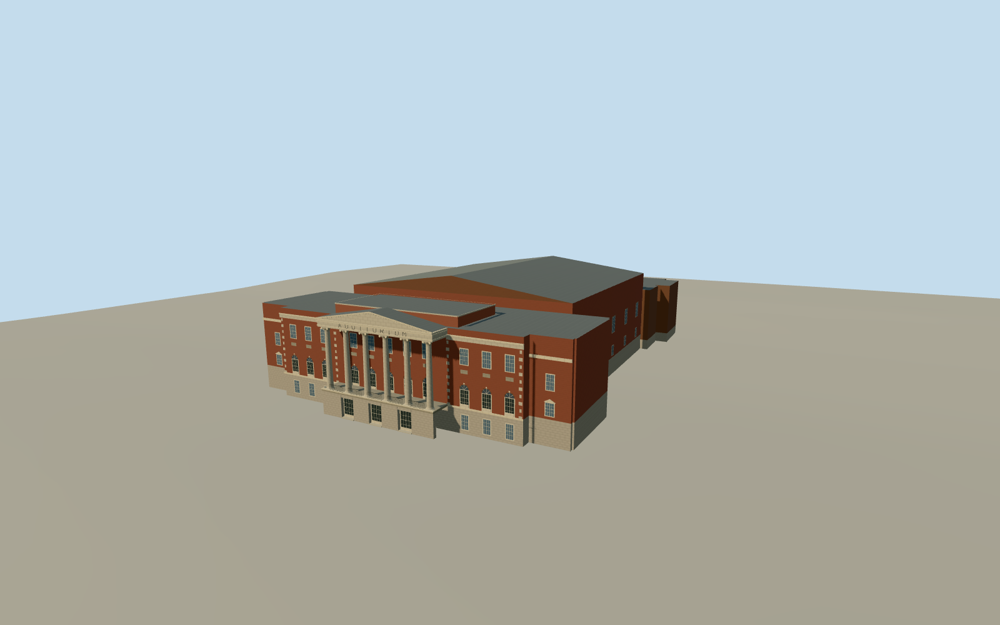

# Foster Auditorium

The University of Alabama auditorium after its 2010 renovation, with six Ionic columns, a lettered limestone pediment and a brick arena behind its historic entry.

Authoring state: **review-in-qa.json**. Current completion evidence is in [qa.json](qa.json) and the [completion ledger](../../../../qualla-structures/batches/qualla-003.PROGRESS.md).

- [Foster Auditorium](https://qualla.com/foster-auditorium/)

The November 2010 exterior references control the restored entrance and masonry. The 2008 original informs permanent Ionic stonework. The freestanding clock tower and plaza are separate from this auditorium model.

The roof forms and heights, service elevations, glazing and Ionic volutes are approximate. The documented main volume and attached rooms follow the mapped perimeter.

The independent elevation field is preserved. Plaza pavement contact is approximate.

Build: `node content/worldgen/source/places/dj/djc/foster_auditorium/models/generate-foster-auditorium.mjs`. Add `--check` to verify exact regeneration. 6277 triangles; 6 materials; no embedded photographs.
