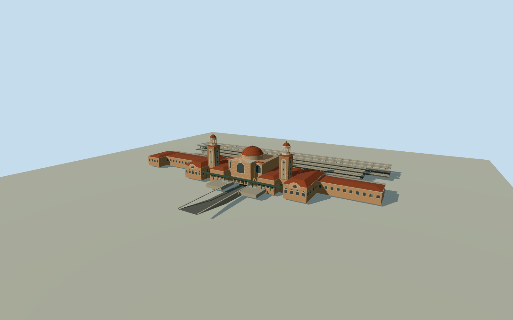

# Birmingham Terminal Station

The Byzantine Revival Birmingham Terminal Station circa 1913, including its twin lantern towers, large terracotta dome, Fifth Avenue subway approach and attached reinforced-concrete train shed.

Authoring state: **review-in-qa.json**. Current completion evidence is in [qa.json](qa.json) and the [completion ledger](../../../../qualla-structures/batches/qualla-003.PROGRESS.md).

- [Birmingham Terminal Station](https://qualla.com/birmingham-terminal-station/)

The former passenger station and attached train shed are shown circa 1913. The demolition date bounds historical visibility. The full interior, freestanding powerhouse, streetcar track, distant railroad yard and later Magic City sign are outside this scope.

Architect’s drawings, dimensions, early exterior postcards and the 1911 survey govern the model. Decorative relief, actual finish tint, baggage and express wing roof breaks, rails and portions of the rear platform envelope are interpreted.

The present-day original terrain is preserved as an independent reference. Historic floor elevations and the grade of the subway approach are approximate. A narrow modeled road cut reveals the original west portal in geographic views.

Build: `node content/worldgen/source/places/dj/djf/birmingham_terminal_station/models/generate-birmingham-terminal-station.mjs`. Add `--check` to verify exact regeneration. 19174 triangles; 6 materials; no embedded photographs.
