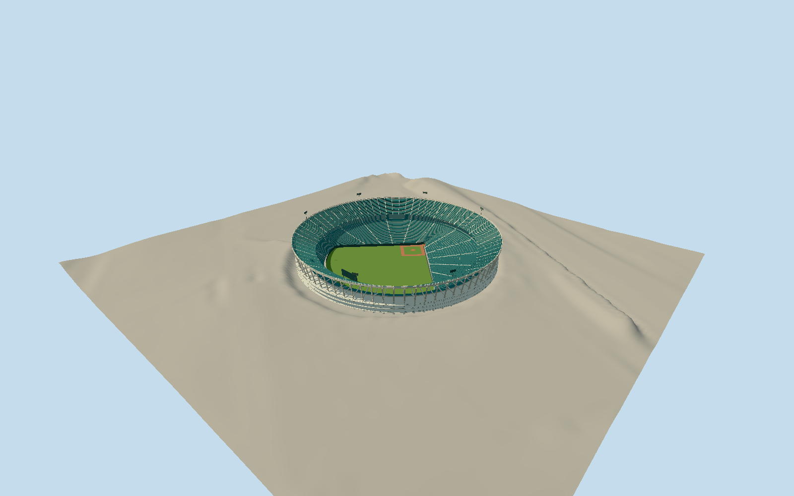

# Atlanta–Fulton County Stadium

Whole circular multipurpose stadium as representative June1974 historical reconstruction: complete asymmetric open baseball field, stepped lower/intermediate/upper seating bowls, white radial bent/raker concrete skeleton, genuinely open exterior concourses and upper stand underside, inset service/gallery ring, portals/aisles, press/scoreboard volumes and restrained rim light banks. Exclude demolished-site parking, current replacement ballpark/Turner Field, cars/vegetation/players/logos/advertisements. White inclined radial piers and inward upper-deck raker buttresses, thin deck edges, recessed internal service ring and actual open concourse slots; avoid a solid tapering drum. Lower field boundary is asymmetric painted native context; complete stepped stadium tiers and open playing field retained allLODs. Muted green/blue seat bands notphotographictexture; explicit seat/lighting/equipment geometry reduced with distance. Approximate1974 silhouette/section/dimensions, no currentworld activation.

Authoring state: **review-in-qa.json**. Current completion evidence is in [qa.json](qa.json) and the [completion ledger](../../../../qualla-structures/batches/qualla-002.PROGRESS.md).

- [Atlanta–Fulton County Stadium](https://qualla.com/atlanta-fulton-county-stadium/)

Native historic stadium node11075183526 identifies former site, not a surviving building. Fit only30 retained curved GreenLot255159838 perimeter points, excluding later southern parking/Turnerlink: centre offset[-4.761886595344958,19.571295692652846]m from historic node, radius113.43642454260034m/RMS0.6081503772466481m; this is an approximate visualization envelope, NOT a measured historical outerwall. Native painted asphalt field1135698204 and HankAaron wall1193413464 are later memorial context; extended foul lines estimate homeplate[0.794150181675338,-45.697693723571916] and baseballaxis heading2.0308569786909016. Fit anchor[-84.38962244092409,33.73941798805949]. Do not extrude current parking parcel or claim modern footprint replacement. Whole historic bowl top32.5m and raker depths/levels/seat counts/lighting/scoreboards approximate from1974 exterior; old ground levels unmeasured.

Single historical field/deck datum fixed before geometry from independent modern source centre sample, not changed by later renders. Individual radial frame footings sample original field; precise1974 bowl excavation/modern grading unknown. No terrain flattening/fitting/reacquisition.

Historical-only representativeJune1974 exterior, explicit1974-06-01 through1974-07-01 viewing range and1974-06-15 capture day; no exact photograph exposure/game-day equipment claimed. Stadium razedAugust1997 and absent from current world. Later1983 own-photo field/fence and2007 post-demolition lot are context, not asserted1974 fitout.

Whole asymmetric open baseballfield/three stepped tiers/open galleries/white radial inclined bent and raker skeleton/upper-deck underside/press box/scoreboard/rim lighting included. Native retained curved lot perimeter only approximates old outer frame; actual old wall/field grade/section/seat census/colors/lighting heights/equipment locations are unmeasured. Low LODs merge seat rows and omit small equipment; no solid drum or extruded parking parcel.

Three exact published Qualla PD originals individually inspected/native SHA1/revisions bound; EPA NARA556790/412-DA-14338 JimPickerell1974/PD-USGov-EPA; Wahkeenah first-person1983 photo and UNCCTF Own2007 photo/PD-user-en. Questionable1960s–70s postcard and1968 unknown media-guide plan excluded/unviewed; all modern CC aerial/demolition photos unused. No metadata/body/category/policy changes, photographic textures, generated bitmaps or downloaded mesh.

Independent512m129square4m16641-sample modern ground/two original Terrarium tiles frozen before geometry; values/heightPNG/tilebytes preserved. Provider297.6978m fixed external approach datum not surveyed1974 construction grade. Single bowl/field datum from frozen source centre and individual bent footings from source; historical excavation/later parking grading/actual host contact unverified. No terrain flattening/fitting/reacquisition or whole-lot platform. Historical dated preview/replacement disabled.

Row bands and aisle treads represent seats without literal52700 individual chairs. Concrete raker sections and gallery widths bounded from one clear exterior; specific fasteners/glass hardware/speaker/electrical elements/signage omitted. No players, logos/advertisements/cars/trees, later Turner Field/newGSU ballpark or post-demolition parking substituted.

Build: `node packages/worldgen/scripts/generate-authored-places.mjs --ids=atlanta_fulton_county_stadium`. Add `--check` to verify exact regeneration. 62200 triangles; 6 materials; no embedded photographs.
