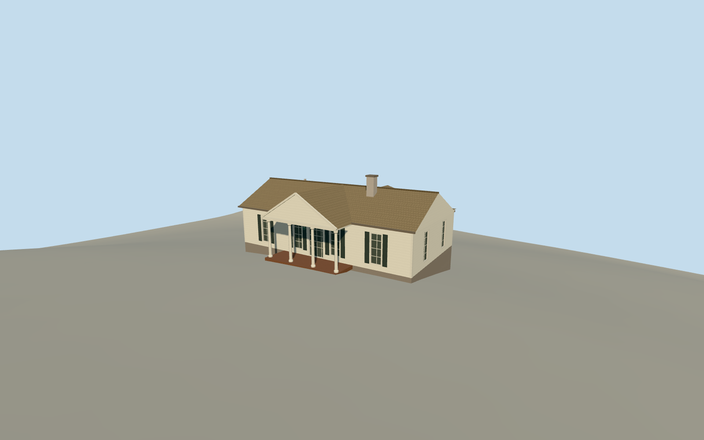

# Little White House

Pale clapboard cottage with a four-column portico, shuttered sashes, a shingle roof and a curved rear sun deck.

Authoring state: **review-in-qa.json**. Current completion evidence is in [qa.json](qa.json) and the [completion ledger](../../../../qualla-structures/batches/qualla-003.PROGRESS.md).

- [Little White House](https://qualla.com/little-white-house/)

The October 2016 photograph sets the white clapboard front, four columns, black-green shutters, roof and chimney. The March 2017 photograph sets the sun deck rail and dark-green fabric awning.

The main outline, porch extent and deck arc come from the named mapped house. Roof pitches, supports below the sun deck, concealed rear openings, and exact foundation and sill heights are estimates.

The separate guest cottage, servants’ cottage and museum are outside the dwelling model. The original local elevations are unchanged.

Build: `node content/worldgen/source/places/dj/djg/little_white_house/models/generate-little-white-house.mjs`. Add `--check` to verify exact regeneration. 3079 triangles; 7 materials; no embedded photographs.
