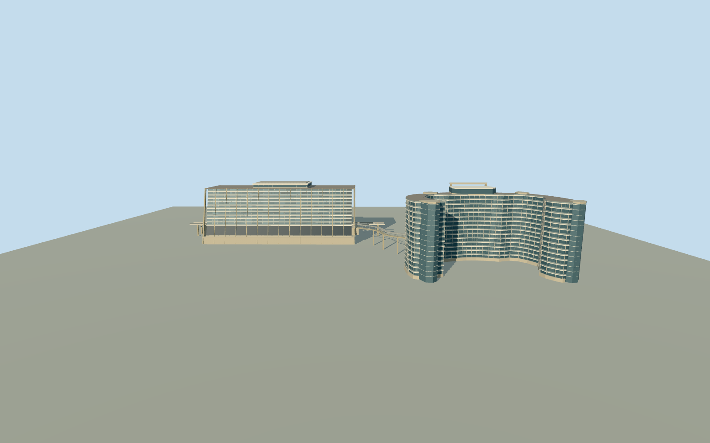

# Disney's Contemporary Resort and Bay Lake Tower

The 1971 resort A-frame and the 2009 crescent Bay Lake Tower with their raised Sky Way Bridge, the two monorail beams through the main concourse, rooftop restaurant and tiered balconies.

Authoring state: **review-in-qa.json**. Current completion evidence is in [qa.json](qa.json) and the [completion ledger](../../../../qualla-structures/batches/qualla-003.PROGRESS.md).

- [Disney's Contemporary Resort](https://qualla.com/disney-s-contemporary-resort/)

Exterior of the two connected towers. Separate Garden Wing and convention center retain their mapped baseline context.

The main tower dimensions and functional levels follow Disney documentation. Individual bays, ramp and bridge heights, and Bay Lake Tower roofline heights and details are reconstructed estimates.

The photographer’s 2010 views establish color and architecture. Recent furniture, refurbishments, fitted interiors, logos and artwork are outside the model scope.

Build: `node content/worldgen/source/places/dj/djj/disney_s_contemporary_resort/models/generate-disney-contemporary-resort.mjs`. Add `--check` to verify exact regeneration. 10754 triangles; 5 materials; no embedded photographs.
