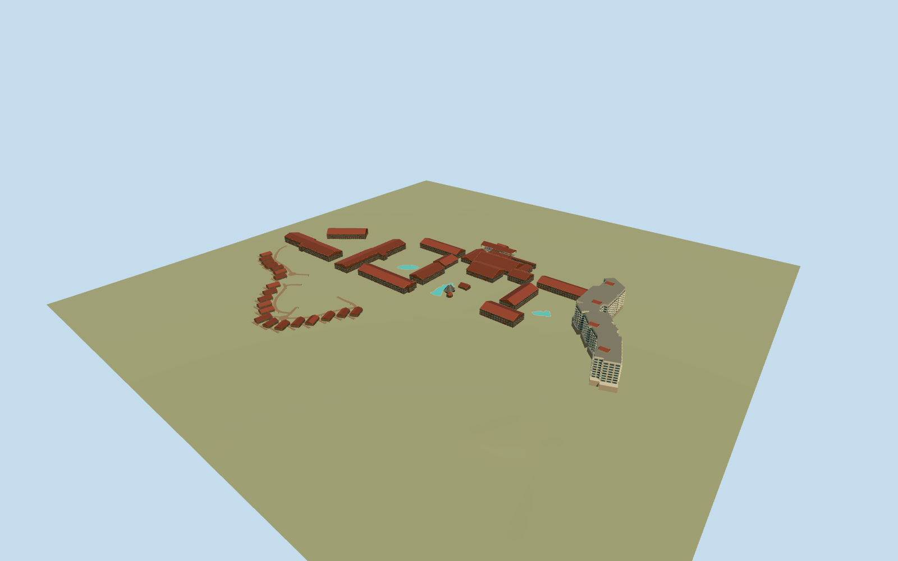

# Disney's Polynesian Village Resort

Seven Seas Lagoon resort with red-roofed longhouses and a timber lodge, a covered monorail station, three linked hospitality areas and a stilt village of overwater bungalows.

Authoring state: **review-in-qa.json**. Current completion evidence is in [qa.json](qa.json) and the [completion ledger](../../../../qualla-structures/batches/qualla-003.PROGRESS.md).

- [Disney's Polynesian Village Resort](https://qualla.com/disney-s-polynesian-village-resort/)

Main and lodge footprints, the lagoon bungalows and their decks, and mapped pools are geographically controlled. Individual roof splits, floor heights, façade colors on unseen walls, and small details of doors, railings, waterslides and tower balconies are estimates.

The current scope includes the site’s principal built forms. Individual decorative works, signs, figures, water effects, landscaped paths and the wider monorail network are outside the reconstruction.

The 2007 Lava Pool photograph establishes the recognizable roof and waterfall rock vocabulary; the current pool rests within its mapped 2018 form. The 2025 lagoon photograph records modern exterior finishes on the original longhouses.

Build: `node content/worldgen/source/places/dj/djj/disney_s_polynesian_village_resort/models/generate-disney-s-polynesian-village-resort.mjs`. Add `--check` to verify exact regeneration. 51893 triangles; 6 materials; no embedded photographs.
