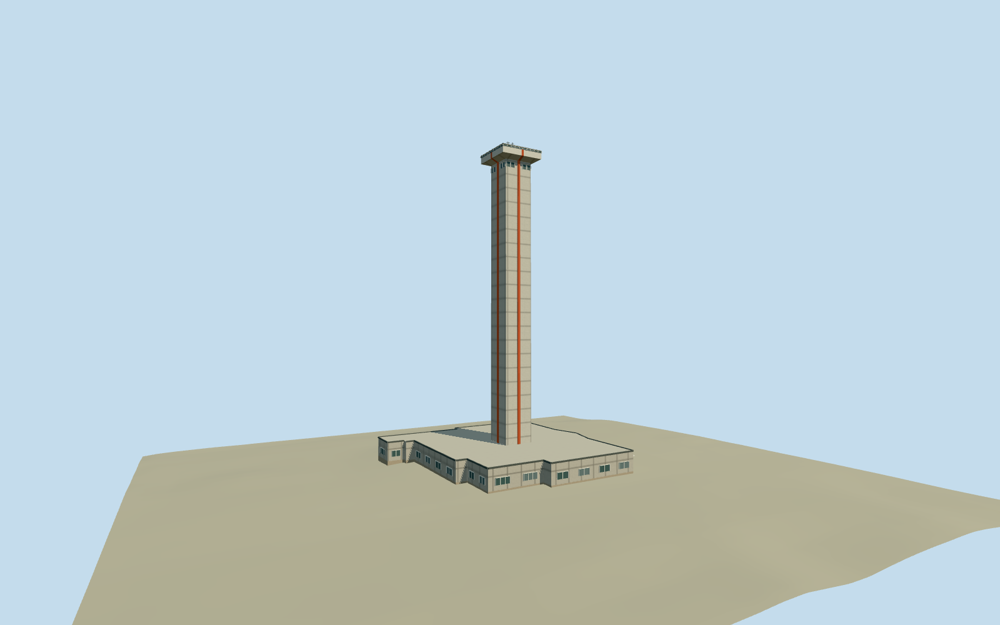

# Florida Citrus Tower

The white Florida Citrus Tower with long orange fins, a projecting glazed observation room, and the connected visitor base.

Authoring state: **review-in-qa.json**. Current completion evidence is in [qa.json](qa.json) and the [completion ledger](../../../../qualla-structures/batches/qualla-004.PROGRESS.md).

- [Florida Citrus Tower](https://qualla.com/florida-citrus-tower/)

Top fascia and shaft follow the documented form. Unpublished wall depths, rear elevations and small roof fittings are approximate.

Scope covers the tower and its connected low base.

Build: `node content/worldgen/source/places/dj/djj/florida_citrus_tower/models/generate-florida-citrus-tower.mjs`. Add `--check` to verify exact regeneration. 2787 triangles; 5 materials; no embedded photographs.
