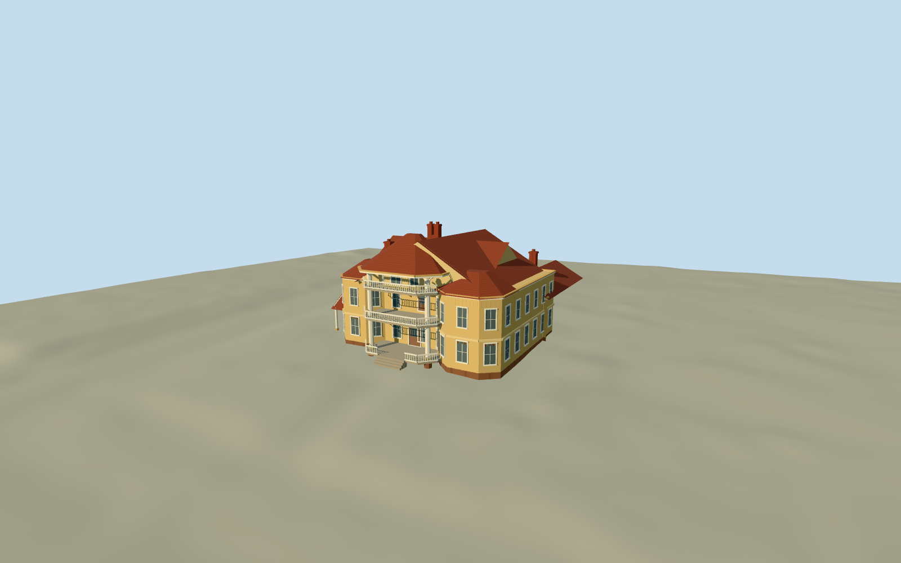

# Lapham–Patterson House

Thomasville’s Lapham–Patterson House, with pale ochre timber siding, polygonal front bays, a three-level open porch and a red roof over the linked rear ranges.

Authoring state: **review-in-qa.json**. Current completion evidence is in [qa.json](qa.json) and the [completion ledger](../../../../qualla-structures/batches/qualla-004.PROGRESS.md).

- [Lapham–Patterson House](https://qualla.com/lapham-patterson-house/)

The working roof ridge positions, side gables and trim ornament are proportional interpretations where the public-domain overhead view is occluded by trees. Interior spaces and individual furnishings are outside the preview.

Build: `node content/worldgen/source/places/dj/djk/lapham_patterson_house/models/generate-lapham-patterson-house.mjs`. Add `--check` to verify exact regeneration. 8020 triangles; 6 materials; no embedded photographs.
