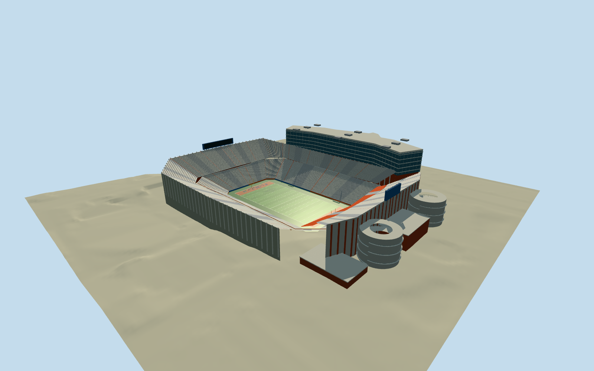

# Ben Hill Griffin Stadium

Ben Hill Griffin Stadium’s recessed grass field, asymmetrical seating decks, west glass skybox, video boards and spiral entry towers.

Authoring state: **review-in-qa.json**. Current completion evidence is in [qa.json](qa.json) and the [completion ledger](../../../../qualla-structures/batches/qualla-004.PROGRESS.md).

- [Ben Hill Griffin Stadium](https://qualla.com/ben-hill-griffin-stadium/)

The model depicts the stadium before the announced future renovation.

Mapped plan and surveyed grade set the placement. Stand heights, individual seat count, roofing divisions and glazing are approximate. Painted field graphics are shown at model scale.

Build: `node content/worldgen/source/places/dj/djm/ben_hill_griffin_stadium/models/generate-ben-hill-griffin-stadium.mjs`. Add `--check` to verify exact regeneration. 21222 triangles; 6 materials; no embedded photographs.
