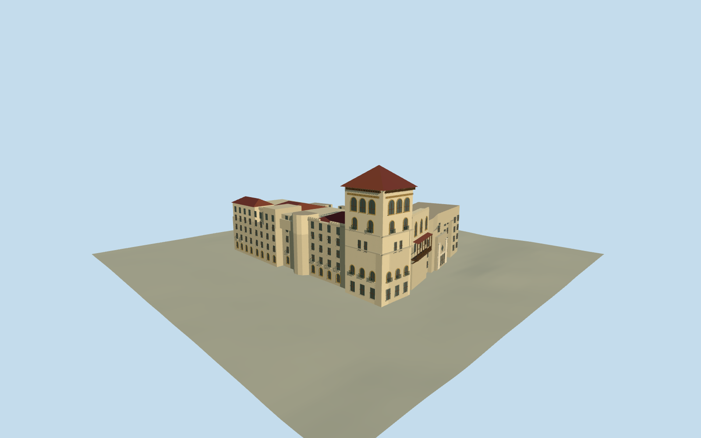

# Casa Monica Hotel

The Spanish and Moorish Revival hotel with its red-roofed corner tower, timber veranda and crenellated parapets.

Authoring state: **review-in-qa.json**. Current completion evidence is in [qa.json](qa.json) and the [completion ledger](../../../../qualla-structures/batches/qualla-004.PROGRESS.md).

- [Casa Monica Hotel](https://qualla.com/casa-monica-hotel/)

The floor heights and detailed ornament are estimated from the photographs. The court elevations and less visible roofs follow the mapped envelope with simplified detail.

Build: `node content/worldgen/source/places/dj/djq/casa_monica_hotel/models/generate-casa-monica-hotel.mjs`. Add `--check` to verify exact regeneration. 13590 triangles; 7 materials; no embedded photographs.
