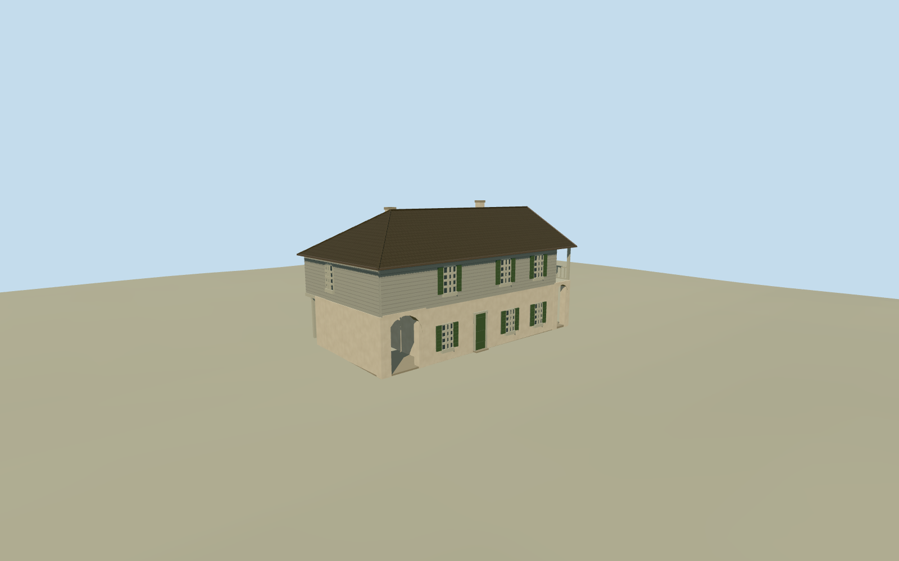

# González–Álvarez House

The restored Spanish Colonial coquina house with white plaster, green shutters, a shingled west hip and street-side arched gates.

Authoring state: **review-in-qa.json**. Current completion evidence is in [qa.json](qa.json) and the [completion ledger](../../../../qualla-structures/batches/qualla-004.PROGRESS.md).

- [Gonzalez-Alvarez House](https://qualla.com/gonz-lez-lvarez-house/)

The roof ridge and exterior joinery heights are proportional estimates. The model represents the standing house and its attached outdoor bays. Small fittings, flags and the separate museum buildings are outside the model.

Build: `node content/worldgen/source/places/dj/djq/gonzalez_alvarez_house/models/generate-gonzalez-alvarez-house.mjs`. Add `--check` to verify exact regeneration. 3560 triangles; 5 materials; no embedded photographs.
