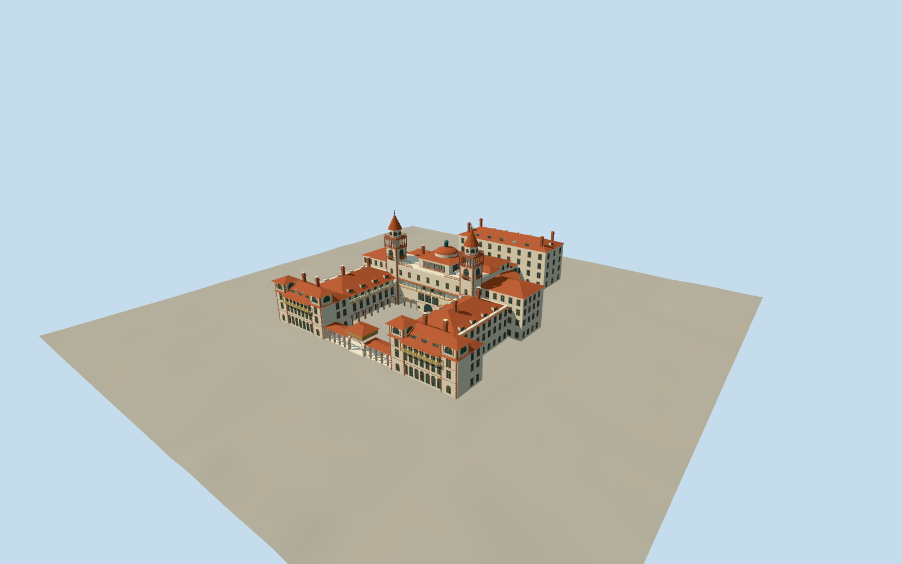

# Ponce de Leon Hotel

U-shaped Spanish Renaissance hotel with open courtyard loggias, ochre timber galleries, paired water towers, central solarium dome, four King Street miradors and curved dining verandas.

Authoring state: **review-in-qa.json**. Current completion evidence is in [qa.json](qa.json) and the [local 100 ledger](../../../../qualla-structures/batches/PROGRESS.md).

- [Ponce de Leon Hotel](https://qualla.com/ponce-de-leon-hotel/)

New tower loggias use exact primary Highsmith public-domain exterior photographs after starting with cleared Qualla candidates. Five bays on each of eight faces; physical simplified spiral shafts and single shared corner columns at close range.

Six flutes and one shaft turn are original medium-fi simplifications, not exact historic carving or measured pitch. Native photographic dimensions, column profiles and concealed elevations remain estimates.

Central upper gallery corrected to nine front arches; close range has actual recessed openings,1.15m-deep reveals and a closed rear room wall. Depth is an authoring estimate; lower levels use opaque opening silhouettes.

Central gallery includes recessed glazing, simple physical lead frames and eight five-flute half-turn shaft reliefs. These are original simplified profiles; precise decorative glazing and historic carving are not reproduced.

Recessed white tower-core enclosures follow the visible native photograph;2.4m radius and hidden cylindrical section are estimates. Street uses closed triangular corner-column profiles and hexagonal cores.

NPS 165-foot tower height governs overall skyline; inconsistent lower map height tags are retained as source evidence. Other vertical dimensions, roof joins and hidden elevations remain estimates.

Main hotel, dining oval and connected original service block included. Separate boiler house/chimney, Artists Studios, later college facilities, interior decoration, fine sculpture and exact inscriptions excluded.

Dated local photographs govern finishes; temporary roof-restoration works visible in current satellite context are excluded. Independent terrain remains unflattened and host-dependent.

Build: `node packages/worldgen/scripts/generate-authored-places.mjs --ids=ponce_de_leon_hotel`. Add `--check` to verify exact regeneration. 63680 triangles; 6 materials; no embedded photographs.
