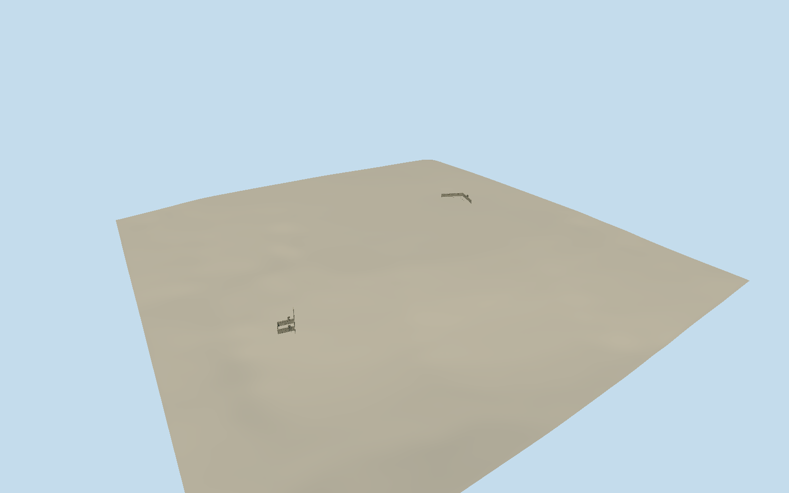

# Andersonville Prison

Present physical reconstructions of Andersonville Prison: both short stockade sections (northgate with rectangular two-gate sallyport and northeast L-corner), their roofed sentry platforms, diagonal-board gate leaves/wicket and short low deadline rail. No invented standing 1864 whole enclosure, barracks or prisoner tents. Separate museum/cemetery/monuments/Providence Spring shelter/Star Fort and general park landscape are excluded. Tall weathered gray pine logs with irregular individual crowns, warm worn endgrain, real faceted cylindrical/hewn profiles, horizontal timber binders, open post-and-rail sentry platforms/lean-to plank roofs on long external posts, two closed diagonal plank gates/black iron straps/pedestrian wicket. Preserve independent site grade. Do not fill field with an invented prison, add a summit-like fort/museum or flatten/reacquire terrain.

Authoring state: **review-in-qa.json**. Current completion evidence is in [qa.json](qa.json) and the [completion ledger](../../../../qualla-structures/batches/qualla-002.PROGRESS.md).

- [Andersonville Prison](https://qualla.com/andersonville-prison/)

All three native OSM fenceway1346210253 vertices bind the northeast reconstructed corner. Exact brown reconstruction paths extracted from federal NPS Harpers Ferry Center ANDEmap1.pdf (2018), whose own asset record explicitly states government-produced public domain, register the northgate wall and rectangular sallyport by affine transformation from those same three corner points. These are visitor-map controls, approximately3m per PDFpoint, not a measured building survey. Whole reconstruction midpoint anchor [-84.12865242639396,32.19546764916732],heading0, +X east/+Z south fixed before terrain/geometry. Mainwall about31m, corner arms about31m; sallyport approximately12x9m. Wallheight4.57m, door/wicket/sentry-platform dimensions, log census and deadline extent are photographic architectural estimates.

Both current reconstructed stockades included; deliberately no full1864standingpalisade or prison interior. Gates are closed physical double leaves with shallow diagonal plank relief/iron straps and closed wicket, not operable doors. Three roofed sentry platforms follow clearphoto evidence; hidden structural joinery/log census and short deadline extent approximate. Rounded timber profiles, uneven crowns and grain are modeled geometry with shared wood material; no photograph texture or generated bitmap.

Two exactpublishedDsdugan2017ownCC0Quallaoverviews and three supplemental Dsdugan2020/2021/2024 ownCC0closeoriginals individuallyinspected/nativeSHA1bound. No uncertain, Panoramio/attribution-only or historicalcamp photo used. ExactassetNPS2018map explicitlygovernmentPD; map registration/census are visitorcartography, not survey. Source/media/category/articlebody/imagerypolicy unchanged.

Independent512m129square4m16641samplefield and two originalTerrariumtiles frozen beforegeometry; modeldatum109.6561m/provider-relative. Timber toes bilinearly follow that unchangedfield; no fitting/flattening/reacquisition/ground slab. Composite DEM does not certify archaeological microrelief or exact thresholds. Ordinary geographic preview/replacementdisabled; actualhostcontact unverified.

Separate nationalPOWmuseum/cemetery/monuments/ProvidenceSpringwellhouse/StarFort/earthenbatteries/wholepark whiteboundaryposts and natural landscape excluded. Asset represents the prison’s two reconstructed architectural fragments today, not the entire26.5acre historic enclosure or a complete1864reconstruction.

Build: `node packages/worldgen/scripts/generate-authored-places.mjs --ids=andersonville_prison`. Add `--check` to verify exact regeneration. 21060 triangles; 5 materials; no embedded photographs.
