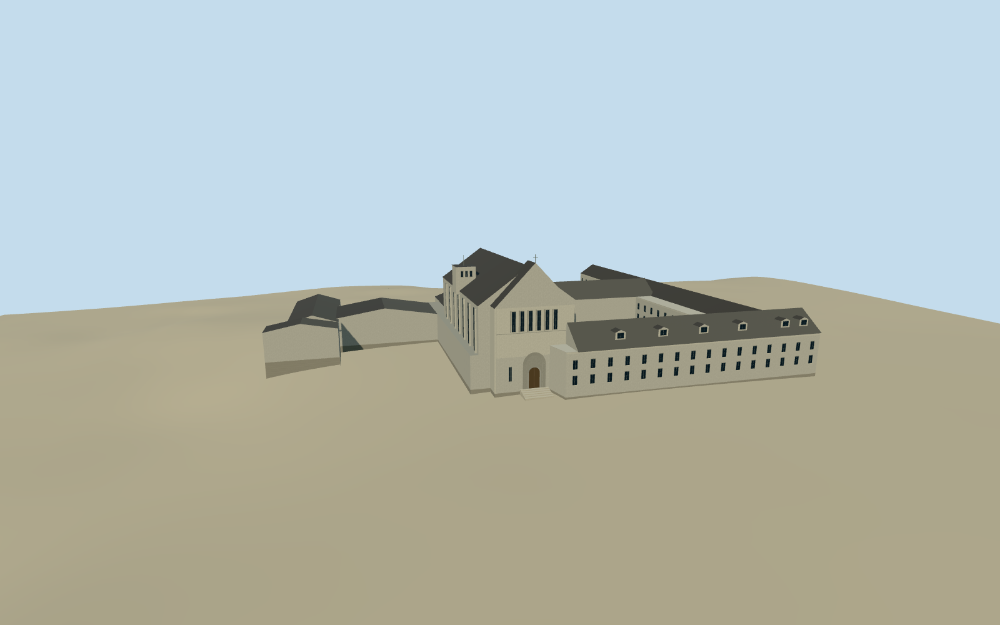

# Monastery of the Holy Spirit

The poured-concrete Conyers Abbey Church with its tall plain gable, recessed arched door and the adjoining dormered monastery wings.

Authoring state: **review-in-qa.json**. Current completion evidence is in [qa.json](qa.json) and the [completion ledger](../../../../qualla-structures/batches/qualla-003.PROGRESS.md).

- [Monastery of the Holy Spirit](https://qualla.com/monastery-of-the-holy-spirit/)

Heights, glazing detail and short roof projections are approximate. The church and adjoining monastery outlines come from the named OpenStreetMap building geometry.

The model covers the standing church and joined core cloister. The removed original monastery and distant visitor facilities fall outside its scope.

Build: `node content/worldgen/source/places/dj/dju/monastery_of_the_holy_spirit/models/generate-monastery-of-the-holy-spirit.mjs`. Add `--check` to verify exact regeneration. 3776 triangles; 6 materials; no embedded photographs.
