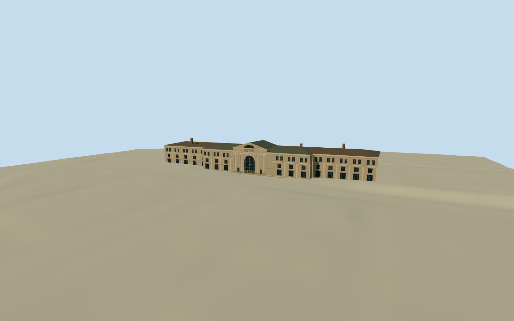

# Terminal Station (Macon, Georgia)

The 1916 Macon Terminal Station, with its three-story Beaux-Arts wings, central arched window and lettered stone pediment at the foot of Cherry Street.

Authoring state: **review-in-qa.json**. Current completion evidence is in [qa.json](qa.json) and the [completion ledger](../../../../qualla-structures/batches/qualla-003.PROGRESS.md).

- [Terminal Station (Macon, Georgia)](https://qualla.com/terminal-station-macon-georgia/)

Heights, opening counts at the remote ends and detail on the track side are architectural estimates. The parcel-mapped building outline supplies the plan.

The main elevation is represented in restored historic form. The relief carvings, window joinery and roof fittings are simplified.

The model ends at the surviving headhouse and attached ranges. Platforms, transit staging and adjoining rail structures are outside its scope.

Build: `node content/worldgen/source/places/dj/dju/terminal_station_macon_georgia/models/generate-terminal-station-macon-georgia.mjs`. Add `--check` to verify exact regeneration. 5136 triangles; 6 materials; no embedded photographs.
