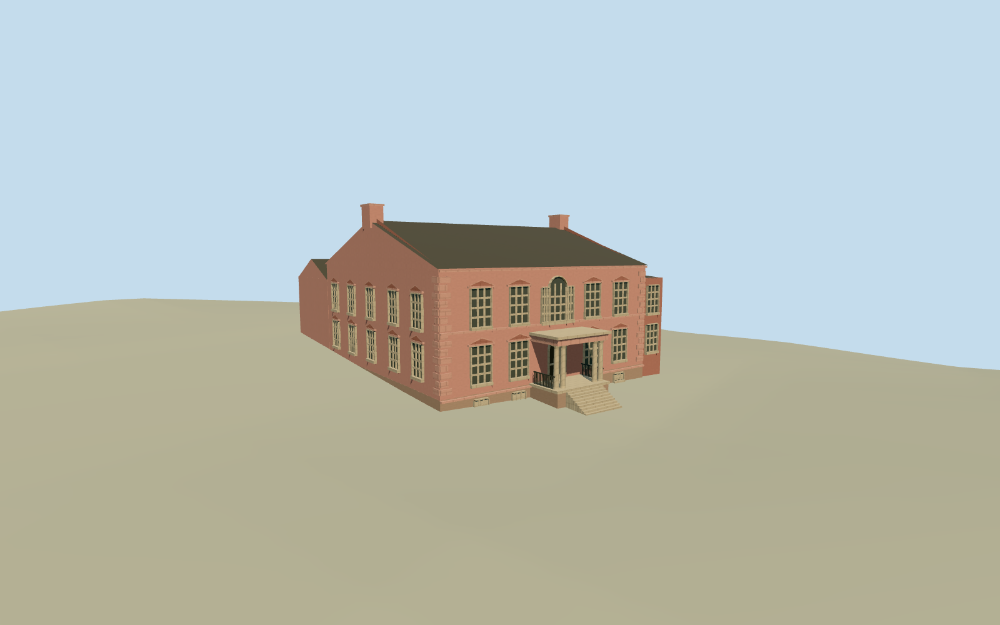

# The Olde Pink House

The Olde Pink House in Savannah, with its stuccoed Georgian exterior, slate gable, Palladian window and four-column Doric porch.

Authoring state: **review-in-qa.json**. Current completion evidence is in [qa.json](qa.json) and the [completion ledger](../../../../qualla-structures/batches/qualla-004.PROGRESS.md).

- [The Olde Pink House](https://qualla.com/the-olde-pink-house/)

Exterior of the standing historic residence and its connected wing. Decorative ironwork and later interior fit-outs are simplified or outside scope.

Unpublished vertical dimensions and secondary window positions are estimated from the survey photographs.

Build: `node content/worldgen/source/places/dj/djw/olde_pink_house/models/generate-olde-pink-house.mjs`. Add `--check` to verify exact regeneration. 6008 triangles; 7 materials; no embedded photographs.
