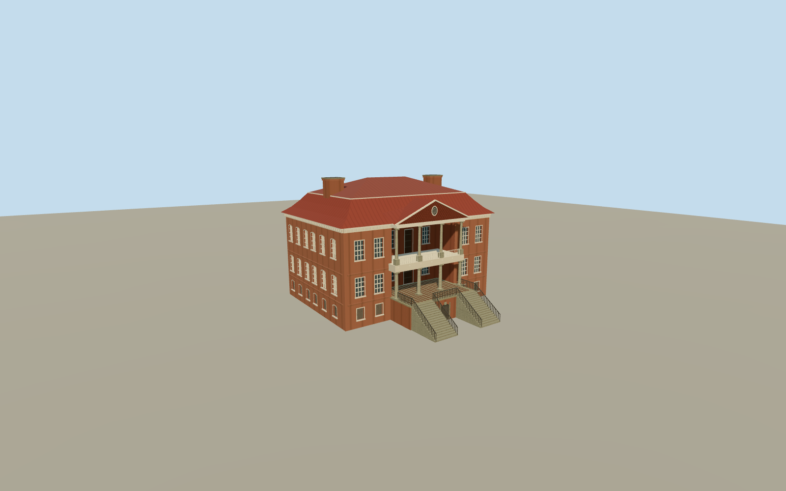

# Drayton Hall

Drayton Hall, with seven-bay brick elevations, a recessed double portico, paired stone stairs and a red two-stage hip roof.

Authoring state: **review-in-qa.json**. Current completion evidence is in [qa.json](qa.json) and the [completion ledger](../../../../qualla-structures/batches/qualla-003.PROGRESS.md).

- [Drayton Hall](https://qualla.com/drayton-hall/)

The survey establishes the main-house dimensions, roof and stair arrangement. Cornice carving, ironwork and column capitals are simplified at this scale, and heights read from the survey scans are approximate.

The original elevation field is unchanged. Landing thresholds and small step adjustments follow the sampled grade. The house represents April 2008 and covers the standing main building and its two approaches.

Build: `node content/worldgen/source/places/dj/djz/drayton_hall/models/generate-drayton-hall.mjs`. Add `--check` to verify exact regeneration. 17370 triangles; 6 materials; no embedded photographs.
