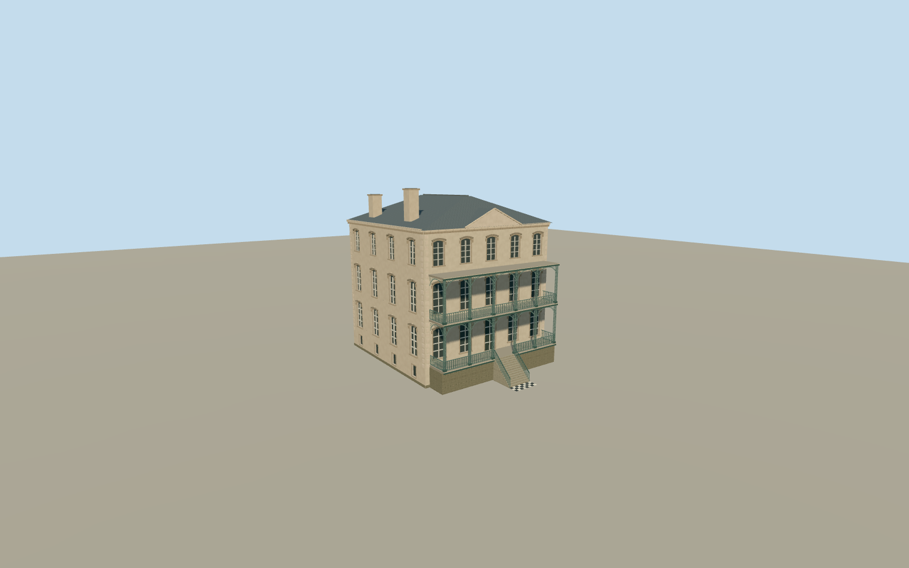

# John Rutledge House

The 116 Broad Street house with a two-story blue-green cast-iron porch, pale five-bay facade, terracotta hoods and slate hip.

Authoring state: **review-in-qa.json**. Current completion evidence is in [qa.json](qa.json) and the [completion ledger](../../../../qualla-structures/batches/qualla-003.PROGRESS.md).

- [John Rutledge House](https://qualla.com/john-rutledge-house/)

The dated photographs control the front and west elevations, color and ironwork. The stepped rear roof and openings, chimney positions and other hidden details are estimates.

The ornamental ironwork reproduces the principal arched profiles, cast foliage and rail spacing at catalog scale. It simplifies individual cast motifs and the small porch furnishings.

The original terrain is unchanged, with approximate sidewalk and entry grade. The model scope is the main house and its street porch.

Build: `node content/worldgen/source/places/dj/djz/john_rutledge_house/models/generate-john-rutledge-house.mjs`. Add `--check` to verify exact regeneration. 21274 triangles; 7 materials; no embedded photographs.
