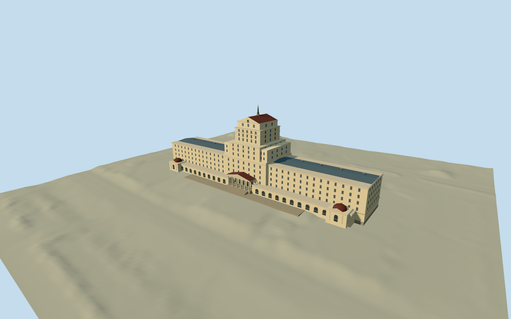

# Ocean Forest Hotel

The pale-fronted 1949 Ocean Forest Hotel, with long five-story wings, a tiered rooftop tower and ocean-facing colonnade.

Authoring state: **review-in-qa.json**. Current completion evidence is in [qa.json](qa.json) and the [completion ledger](../../../../qualla-structures/batches/qualla-004.PROGRESS.md).

- [Ocean Forest Hotel](https://qualla.com/ocean-forest-hotel/)

The footprint is a calibrated architectural estimate from original illustrations, the surviving traffic circle and the coarse 1952 aerial index.

Unmeasured wall heights, minor service openings, individual roof details and original grades are approximate.

Build: `node content/worldgen/source/places/dj/djz/ocean_forest_hotel/models/generate-ocean-forest-hotel.mjs`. Add `--check` to verify exact regeneration. 35800 triangles; 6 materials; no embedded photographs.
