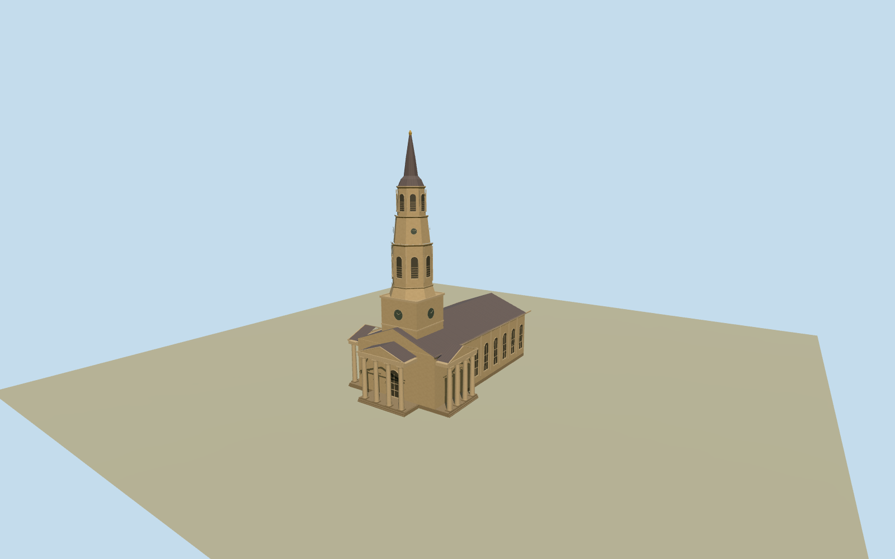

# St. Philip's Church (Charleston, South Carolina)

St. Philip’s Church in Charleston with three classical porticoes, the curved sanctuary and the tapering Church Street steeple.

Authoring state: **review-in-qa.json**. Current completion evidence is in [qa.json](qa.json) and the [completion ledger](../../../../qualla-structures/batches/qualla-004.PROGRESS.md).

- [St. Philip's Church (Charleston, South Carolina)](https://qualla.com/st-philip-s-church-charleston-south-carolina/)

The standing church, porticoes and steeple. Adjacent Good Shepherd Chapel, churchyard and interior lie outside scope.

The steeple uses the mapped height, and intermediate heights and ornament are estimated.

Build: `node content/worldgen/source/places/dj/djz/st_philip_s_church_charleston_south_carolina/models/generate-st-philip-s-church-charleston-south-carolina.mjs`. Add `--check` to verify exact regeneration. 7576 triangles; 6 materials; no embedded photographs.
