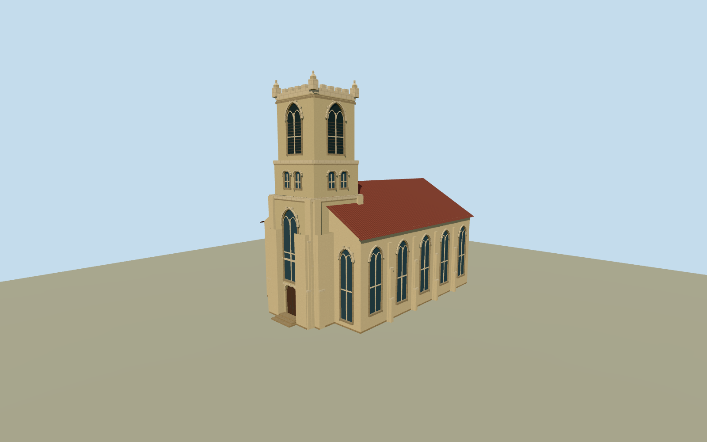

# Unitarian Church in Charleston

Charleston’s Unitarian Church, with a crenellated four-storey Gothic Revival tower, tall hooded lancets, a Tudor entrance, cream masonry and red nave roof.

Authoring state: **review-in-qa.json**. Current completion evidence is in [qa.json](qa.json) and the [completion ledger](../../../../qualla-structures/batches/qualla-004.PROGRESS.md).

- [Unitarian Church in Charleston](https://qualla.com/unitarian-church-in-charleston/)

The tower elevation is scaled from photographs against the mapped church and documented lancet height. The proportions of some tracery, the back and the small roof projections are estimated. Interior and churchyard objects are outside the scope of this model.

Build: `node content/worldgen/source/places/dj/djz/unitarian_church_in_charleston/models/generate-unitarian-church-in-charleston.mjs`. Add `--check` to verify exact regeneration. 12316 triangles; 6 materials; no embedded photographs.
