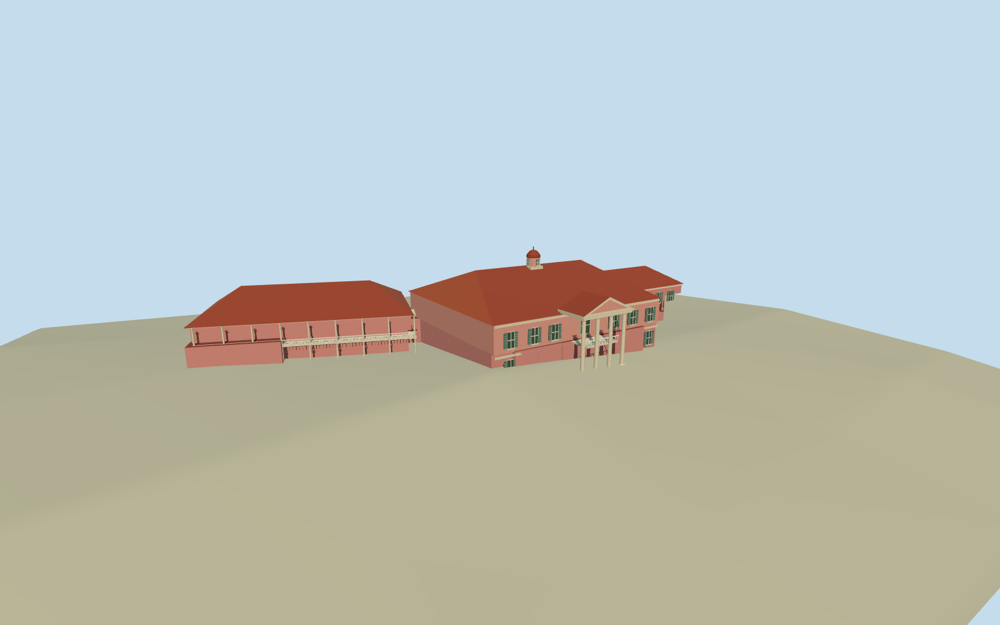

# Government House, Nassau

Nassau Government House on Mount Fitzwilliam, with pink walls, white portico and verandas, red hip roofs and a centered cupola.

Authoring state: **review-in-qa.json**. Current completion evidence is in [qa.json](qa.json) and the [completion ledger](../../../../qualla-structures/batches/qualla-004.PROGRESS.md).

- [Government House, Nassau](https://qualla.com/government-house-nassau/)

Draft exterior: approximate photographic proportions and simplified ornament. It is not a survey, photogrammetric reconstruction or approved current geographic replacement.

The Tichnor production postcard shows the restored portico, red hip roofs and centred cupola. The Ministry of Tourism records the pink plaster and white trim of the standing residence.

Terrain sampling/contact, geographic alignment and site activation remain pending. Runtime LODs are produced by the registered after-import pipeline and require visual review.

Reference photos remain in the local Qualla corpus; only provenance, paths and hashes are retained here.

Build: `node content/worldgen/source/places/dk/dk2/government_house_nassau/models/generate-government-house-nassau.mjs`. Add `--check` to verify exact regeneration. 11531 triangles; 6 materials; no embedded photographs.
