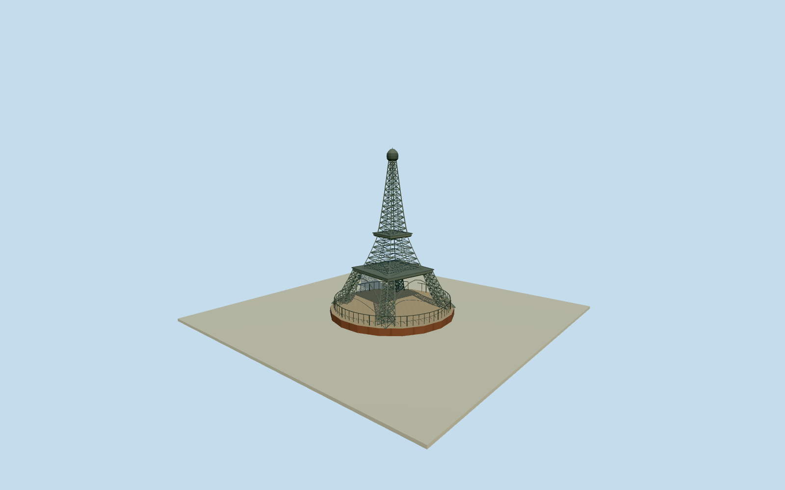

# Eiffel Tower (Paris, Tennessee)

Paris, Tennessee’s sixty-foot Eiffel Tower replica, with four flared open lattice legs, two decks and a domed platform over a circular brick base.

Authoring state: **review-in-qa.json**. Current completion evidence is in [qa.json](qa.json) and the [completion ledger](../../../../qualla-structures/batches/qualla-003.PROGRESS.md).

- [Eiffel Tower (Paris, Tennessee)](https://qualla.com/eiffel-tower-paris-tennessee/)

December 2021 exterior geometry. Seasonal light ornaments, small signs and nearby playground fixtures are outside scope.

The 60-foot height follows the City of Paris park listing. Intermediate deck heights, axis rotation and lattice dimensions are estimates drawn from the cleared photograph and platform outline.

Build: `node content/worldgen/source/places/dn/dn3/eiffel_tower_paris_tennessee/models/generate-eiffel-tower-paris-tennessee.mjs`. Add `--check` to verify exact regeneration. 13153 triangles; 3 materials; no embedded photographs.
