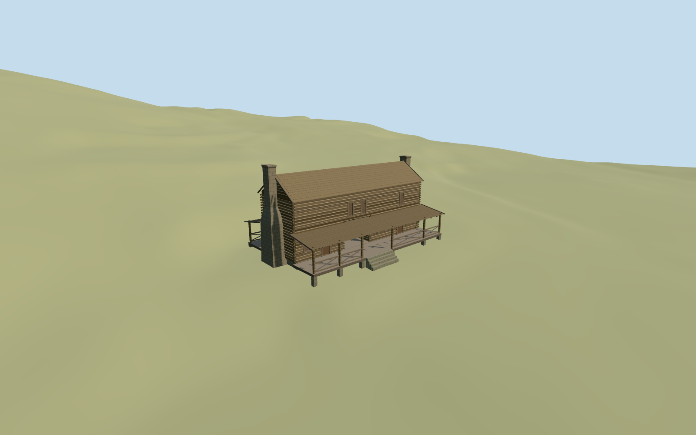

# John Ross House (Rossville, Georgia)

The relocated square-log John Ross House, with two stone chimneys, two shingled porches and an open central dogtrot.

Authoring state: **review-in-qa.json**. Current completion evidence is in [qa.json](qa.json) and the [completion ledger](../../../../qualla-structures/batches/qualla-003.PROGRESS.md).

- [John Ross House (Rossville, Georgia)](https://qualla.com/john-ross-house-rossville-georgia/)

The model is placed on the mapped relocated footprint. Stone widths, log seam irregularities, deck heights and roof rises are approximate.

The archive views document details of the same cabin before it moved. Front and rear porch arrangement and visible finish follow the National Park Service photographs of the standing relocated house.

The neighboring outbuilding, modern planting, roof moss, memorial markers and interior furnishings are outside scope.

Build: `node content/worldgen/source/places/dn/dn5/john_ross_house_rossville_georgia/models/generate-john-ross-house-rossville-georgia.mjs`. Add `--check` to verify exact regeneration. 6740 triangles; 8 materials; no embedded photographs.
