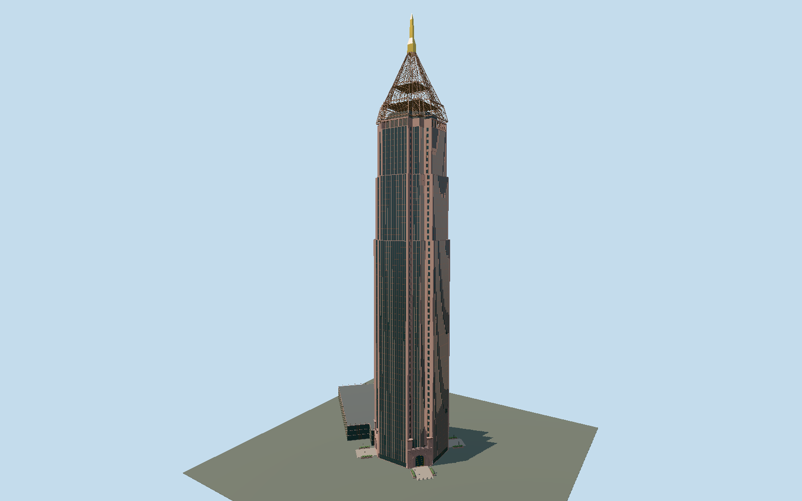

# Bank of America Plaza

Atlanta’s 55-floor red-granite tower: stepped square plan, narrow glass ribbons and paired structural piers, four deeply recessed corner portals, a three-level west gallery and an open stepped aluminum crown below the gold obelisk.

## Evidence and reconstruction

Published dimensions and reconstructed details are separated in spec.json. Primary references:

- [Reference](https://www.architectmagazine.com/project-gallery/bank-of-america-plaza/)
- [Reference](https://www.bankofamericaplaza.com/wp-content/uploads/2023/12/CPGroup-BankofAmericaPlaza-Atlanta-Brochure.pdf)
- [Reference](https://www.usmodernist.org/AR/AR-1992-08.pdf)
- [Reference](https://www.skyscrapercenter.com/building/id/429)
- [Reference](https://homepages.bluffton.edu/~sullivanm/atlanta/rochedink/bank.html)
- [Reference](https://www.bankofamericaplaza.com/)
- [Reference](https://www.openstreetmap.org/way/39449840)
- [Reference](https://www.openstreetmap.org/way/886044291)

No third-party geometry, photograph or bitmap texture is embedded. Shared surface graphs come from the central library; vertex tints carry model colors. Glazing uses PBR materials; transparent surfaces are declared per model.

## Model and axes

60,897 triangles; 150,181 vertices; 4 material groups; 6,140,112 bytes. Native bounds: -105.453, 0.000, -67.124 to 32.598, 311.800, 32.598. Source hash: `sha256:1cc7770e6052479be9c3ea5c6fb3b3c79ba76267d30daeb208196bb3a00ad450`.

{"up":"+Y","front":"+Z southeast","longAxis":"+X northeast"}

Fresh 2026-10-10 exact Q499486 tower way 39449840, attached western three-level wing way 886044291 and all three door nodes retain unchanged raw coordinates against independently preserved original evidence. Scaled Mercator projection matches the original tower outline within 0.001 m rounding. Anchor [-84.386135531,33.770865329] and heading 0.766815 retain +X northeast bearing 46.065 degrees and +Z southeast bearing 136.065 degrees. The asymmetric mapped west wing on negative X and the independently mapped north/east/west portals sign square-plan ambiguities. Main stepped shaft is regularized within 1 m; west wing retains its irregular ring. Published 311.8 m architectural tip, 222 m occupied height, 55 floors and 27.432 m gold spire govern reconstructed proportions. Intermediate setbacks, arches, cage pitches, stairs and ground grades are not surveyed. Y0 approximates the local apron on a hillside; no cadastral or curb-level accuracy is claimed, and no map footprint is replaced. Current owner states west-wing restaurant is forthcoming; proposed redesigns, neighboring Emory parking, street trees and hidden interiors are excluded.

## Reproduce

Run `node packages/worldgen/scripts/generate-signature-towers.mjs --ids=N0207` (or add `--check`). The generator preserves manually edited masters by checking their baseline hashes. Import through the standard authored-model workflow with optimization disabled; then capture all QA cameras, including shared-surface views.

## Pending work

- Unchanged atlantaStudy.build preserves the original 401,609-triangle, 34,323,260-byte recipe. Separate reviewed master retains the three stepped shaft stages, deeply recessed five-layer granite arches, narrow glass ribbons and projecting granite fins, attached irregular three-level west wing, open stepped rouge tube cage with inclined legs/braces, internal plant/catwalks, service ladder, lamp housings and 27.432 m faceted gold spire. Continuous shared granite replaces individually closed masonry blocks; metric projected course strips retain near joints. Full-height fins replace repeated closed floor fin pieces. Near arches use 16 segments, above-opening wall matched to the same 16-segment outer arch, crown tube pitch 1.12 m with four-sided sections, ladder rungs 0.72 m and sampled roof posts/8-by-4 shrubs. Street uses half floor courses, seven principal ribbons, five four-segment arch layers and sparse open crown rings with all twenty inclined legs; district uses flat facade fins, coarse arches, four principal ribbons and sparse open crown rings with eight inclined legs. Above-arch wall polygons match the outer archivolt tessellation at every level to close seams. Near facade has one projected spandrel per floor and granite fin-joint strips; individual pane-top transoms are omitted. District/street shaft cornices use flat projected ribbons, and street return-window stiles omit fine closed frames. Skyline retains stepped masses, asymmetric west wing, recessed faceted arch opening, sparse open crown and gold tip, omitting facade rhythm, plants, stairs, fine hardware and crown infill. Granite also approximates tinted foliage/paving; gold uses tinted shared stainless; entry glazing is an opaque palette rather than an interior model. Nighttime crown illumination is not baked into daytime surfaces. Physical devices, dense-city timings and global simplification error bounds remain unmeasured.

This bundle follows the medium-fi standard. Medium-fi appearance and geographic fit are reviewed separately. Hash-bound visual acceptance is recorded separately after capture inspection.
