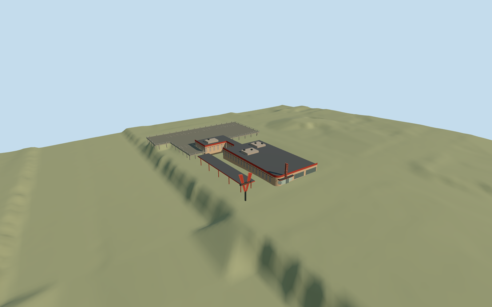

# The Varsity

Atlanta’s original Varsity restaurant with the curved porthole entrance, tapered marquee, red carhop canopy, roadside V and raised Lunching Pad.

Authoring state: **review-in-qa.json**. Current completion evidence is in [qa.json](qa.json) and the [completion ledger](../../../../qualla-structures/batches/qualla-003.PROGRESS.md).

- [The Varsity (restaurant)](https://qualla.com/the-varsity-restaurant/)

The standing North Avenue location is modeled. The parking deck section, roof plant, sign lettering, colors, light levels and curving glazing are simplified.

The west roadside sign stands at an approximate position derived from the night street view and operator record. Third-party advertising, interiors, cars and landscaping are outside scope.

Build: `node content/worldgen/source/places/dn/dn5/varsity_restaurant/models/generate-varsity-restaurant.mjs`. Add `--check` to verify exact regeneration. 3657 triangles; 6 materials; no embedded photographs.
